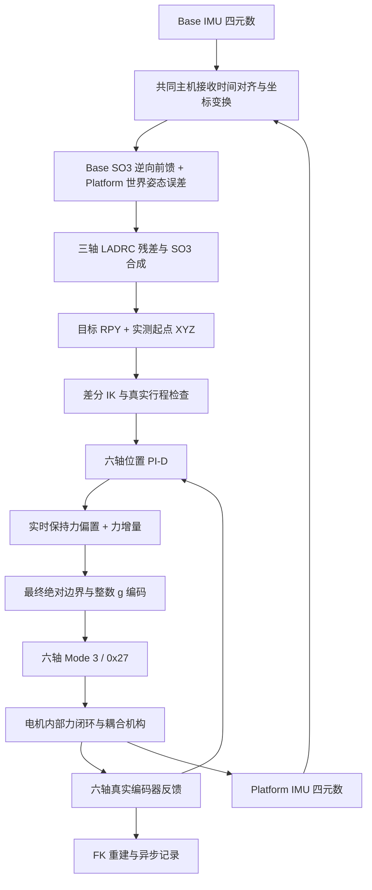

# 6PUS 原生力控与双 IMU 主动稳定

本工程研究在 **六个电机全部运行厂家原生 Mode 3 力控模式**时，如何利用编码器位置反馈实现 6PUS 并联机构的位姿运动与双 IMU 主动姿态稳定。上位机将姿态目标经 IK 转换为六轴位置参考，由六轴位置 PI-D 产生轴向力指令；电机内部力闭环执行这些指令。主动稳定控制 Roll、Pitch、Yaw，平移参考保持本次实测起始位姿。

**当前主入口是三进程双 IMU 原生力控长期运行程序**，包含正常退出后自动返回 Home 的后续工作区实现。Z 轴、单轴、组合轨迹及早期研究入口仍各自保留，参数不能相互套用。[完整文档导航](docs/README.md)提供当前说明和历史归档入口。

版本说明：`mode3-native-capacity-20261107` 对应 `46081f59b1a01705e9fb9780fd647e64a2352177`，正式保留三进程原生能力输出策略；当前工作区还包含后续长期运行及自动 Home 修改。不要把这些后续功能归入该标签。本次文档整理不修改标签，不提交或推送。

## 背景与控制输入

Position 工程已经建立双 IMU 姿态控制、运动学和 J14 长时间运行架构，以位置伺服指令执行运动。Torque 工程保留了力反馈辅助位置控制及力矩研究原型；不能仅凭工程名称将其解释成已验证的电机轴力矩接口。本 Force 工程使用电机的原生轴向力接口，研究外层位置/姿态控制与内层电机力闭环之间的动态关系。

| 工程/路径 | 主要执行器输入 | 与当前 Force 的关系 |
|---|---|---|
| Position J14 | Servo Mode 1，`0x29` 位置 | 姿态算法、IK、独占 UART 和三进程机制的来源 |
| Torque / 继承的 Route A | 主要为 `0x29` 位置；部分研究仅离线 | 力反馈辅助位置、力矩概念与原生力模式须区分 |
| 本工程三进程主动稳定 | Force Mode 3，`0x27` 有符号目标力，单位 **g** | 外层六轴位置 PI-D + 电机内部力闭环 |
| 正常退出后的 Home | 独立 J7 Servo Mode 1，`0x29` 位置 | 力控已经停止后才启动，不属于 Mode 3 主动控制阶段 |

LAF 力闭环电缸带内部力传感器，`0x2C` 提供实际力反馈、`0x2D` 提供 ADC 原始值。Mode 3 接收 `0x27` 目标力，由设备内部闭环驱动电缸；内部控制器具体增益、采样率及负载下带宽在现有资料中没有充分证据。本工程不会把目标力读回当成实际力，也不会把指令已经发送当成机构已经响应。

## 机构与完整控制链

6PUS 是具有六条支链、六个直线执行器的 Stewart 类并联机构。六个编码器位置共同决定平台位姿，各执行器通过机构耦合，不是六个互不影响的独立负载。Base IMU 测量基座姿态变化，Platform IMU 测量平台姿态变化；FK 由六轴编码器重建位姿，不能替代外部绝对位姿测量。



两路输入采用 H30 已融合四元数，本入口不重新设计原始陀螺仪/加速度融合。捕获各自初始姿态，沿用 Position 的 `Rz(+90°)` 机械坐标变换，通过 SO(3) 计算平台相对固定世界参考的误差；Base 逆向前馈和 LADRC 角度残差合成新的目标姿态。Classical P/PD 仅作为对照记录，不与 LADRC 再次叠加。

双 IMU 使用最新共同**主机单调接收时间**进行 SLERP 插值，不外推。ROS header 和主机接收时间都不代表设备硬件同步采样。IK 以本次实测六轴位置及其 FK 为起点，采用差分锚定，不假设电机都在 1000 steps；无起点 ±100 steps 小框，也不以 SO(3) 缩放悄悄削减不可达目标。不可达目标、IK 状态和剩余行程分别记录。[坐标、同步和控制公式](docs/control/dual_imu_position_force.md)。

当前主动链**不是任务空间 Z 力 PID，也不通过 Jacobian 将任务 Wrench 分配成六轴控制力**；相关早期探索保留在[历史阶段归档](docs/archive/README.md)。

## 三进程运行架构

| 进程 | 负责内容 | 隔离的阻塞工作 |
|---|---|---|
| Parent | ROS 双 IMU、姿态/SO(3)/LADRC、IK、阶段协调、最新完整参考发布、Lease | 不打开电机 UART；ROS Executor 与目标生成分开调度 |
| UART Child | 唯一电机串口所有者；50 Hz 六轴位置 PI-D、Mode 3/力事务、实时反馈检查、故障停止 | 不运行 ROS、FK 或同步文件记录 |
| Feedback Bridge | 唯一反馈 socket 消费者；ROS 反馈发布、FK、tracking 和异步文件记录 | FK/存储不占 UART 控制循环 |

两路 H30 节点是额外的传感器进程，不计入上述三个电机控制进程。IPC 沿用 J14 的非阻塞 `AF_UNIX/SOCK_SEQPACKET`、epoch、单调序号和最新值覆盖。Parent 发完整 **IK 位置参考**，Child 根据最新实际位置计算力，不跨进程积压旧力指令。

Parent Lease 1000 ms 与 IK 参考新鲜度 200 ms 独立；心跳不能延长旧目标寿命。Mode 3 确认后必须接到该时刻之后发布的有效参考，才开始固定 1 秒 `initial_hold`，随后进入 `stabilize`。模式/`0x27` 读回分散到不同周期，避免每秒集中十二次同步查询。指令序号、UART 周期序号、PID 输入反馈序号及各轴接收时间分别保存。[架构、时序与失效边界](docs/architecture/three_process.md)。

## 六轴 PI-D 与当前有效参数

以下值仅描述当前三进程入口，来源为 `mode3_process_policy.py`、`mode3_dual_imu.py`、`z_position_motion.py::pid_config` 和 `joint_position_force_pid.py` 的组合，不能用通用类默认值代替最终生效值。

| 项目 | 三进程当前行为 |
|---|---|
| 控制循环 | 50 Hz，标称 20 ms；真实周期以记录为准 |
| 六轴 Kp / Ki / Kd | 均为 8000 N/m、6000 N/(m·s)、1000 N·s/m |
| 积分输入 | 真实 `q_ref - q_encoder`；±1 step（25 μm）死区 |
| P 项 | 预测位置误差；预测时域为各轴反馈年龄 + 20 ms |
| 速度及 D 项 | 80 ms 窗口连续线性回归，40 ms 一阶滤波；`D = -Kd × 速度` |
| PI-D 增量 / 积分独立上限 | 不设置；已取消旧 ±4 N / ±2.5 N 实验限幅 |
| 正常位置参考速度 / 力指令变化率 | 不设置；没有 0.2 mm/s、500 g/s 人为整形 |
| 最终目标 | 本次实际 `0x2C` 保持偏置 + PI-D 增量，包含偏置一起限制到 ±50 N 规格边界 |
| 原生整数编码 | **±5098 g**；名义 `1 g = 0.00980665 N` |
| 抗积分饱和 | 最终实际编码输出饱和且积分会加深饱和时，条件回退积分；量化误差单独容忍 |
| 跟踪误差 | 完整记录；三进程已取消旧 2.5 mm 参考误差硬退出 |

同一个 PI-D 实例跨初始保持和主动稳定，积分与速度状态连续交接。LADRC 参数沿用 Position：Roll/Pitch/Yaw 的 `(b0, ωc, ωo)` 分别为 `(20,0.8,2.5)`、`(10,1.0,4.0)`、`(6,0.25,1.2)`，原算法角度残差上限各 ±0.5°；这是残差控制器边界，不是基座扰动幅值上限。[原生能力策略、厂家依据和回放](docs/control/native_capacity.md)。

## 产品规格、软件边界与安全

LAF50-024D 选型规格的最大推拉力为 **50 N**。主机按该规格将含保持偏置的绝对指令限制到 ±50 N，向内量化到 ±5098 g，约 ±49.9943 N。±100 N 传感器量程、80 N 堵转/自锁指标、int16 编码范围均不能替代正常目标力边界。

**±5098 g 是本工程的主机指令边界，不是已经证实的固件自动 50 N 保护寄存器。** 手册的 `0x20` 是 mA 电流保护，`0x21/0x22` 是输出上限（表列 0–1000），不是以 N 或 g 表示的力钳位。启动时只读这些设置，不覆盖设备保护。g→N 是名义换算，不是六轴绝对受力标定；历史 Tare 也不能证明预载消失。[电机、传感器和寄存器依据](docs/hardware/native_force.md)。

当前保留的保护包括：

- **1500 mA** 共享电流基线；旧阶段的 500 mA 不代表当前三进程生效值。
- 几何正常范围、合法命令范围与设备读回行程的交集，通常 **200–1800 steps**；实际位置和 IK 目标分别检查、分别记录，不取消机械边界。
- 有效反馈、六轴位置时间戳（200 ms）、双 IMU 姿态时效（各 100 ms）、通信/写超时、故障码、Mode 3 及 `0x27` 读回检查。
- Parent Lease、参考新鲜度和 Bridge 健康检查；运动写入不盲目重试。
- 原异常 Pause、Mode 0 实测位置重锚和六轴退出确认；5000 g/s 只在原允许的健康反馈停止/恢复路径使用，不作用于正常主动力指令。

Child 失效且已无法执行代码（例如 SIGKILL 或主机掉电）时，软件不能保证继续发送停止指令；报告必须允许 `exit_unconfirmed`。Mode 0 确认、Pause ACK、串口关闭和物理停止是不同事实。软件停止不能替代独立的现场停止手段。

## 长期运行与正常退出回 Home

长期脚本自动加载 ROS 2 和本工程工作空间，默认三轴、持续运行；未加真实硬件选项时使用合成 IMU/Mock。真实运行中，固定 1 秒初始保持后持续 `stabilize`，不按 60 秒自动结束。每次使用独立目录，终端日志与完整记录分开保存。

正常 Ctrl+C 的当前流程：停止参考流 → Child 安全停止原生力控 → **确认六轴 Mode 0 并回收三进程/关闭 IMU** → 复用独立 J7 HOME runner 重新取得电机串口 → 读取实际六轴位置 → 切换 **Servo Mode 1** → 50 Hz 五次平滑位置轨迹回 Home → 默认保持 2 秒 → 六轴 Pause、最终位置读回、关闭串口。

Home 默认规划峰值 50 steps/s（1.25 mm/s），与正常 Mode 3 不限参考速度的策略无关。原 runner 使用有限轨迹长度和逐次通信超时，末端允许最大 5 steps 误差；异常/中断执行原 Pause。**它不是持续等待任意时长直至收敛，也没有独立全局壁钟回 Home 超时。当前 Home 后执行 Pause，未再次切换并确认 Mode 0；报告中的 Mode 0 是回 Home 之前力控退出的确认。**

仅 `operator_stopped`、连续模式、六轴 Mode 0 已确认且无 Parent error 时允许自动 Home；故障、启动异常或停止未确认均跳过 Home。实现也把结果目录中的 `stop_request.json` 正常停止请求归为 `operator_stopped`。`--no-auto-home` 可显式禁用该动作。控制故障不会自动转入位置运动。[完整启停及异常说明](docs/operations/long_running.md)、[Home 定义与实现边界](docs/operations/home.md)。

## Home 的配置来源

Home 是工程的 **OPERATING_HOME**，六轴目标 `[1000,1000,1000,1000,1000,1000] steps`，不是自动寻找限位开关的机械回零，也不是 `STORAGE_PARK=[0]*6`。

其来源为 [6pus_geometry.yaml](bone_ws/src/pus6_kinematics/config/6pus_geometry.yaml) 的 `actuator.operating_home_raw_steps`；[geometry_config.py](bone_ws/src/pus6_kinematics/pus6_kinematics/geometry_config.py) 校验该约定，共享 [safety.py](bone_ws/src/pus6_motor_driver/pus6_motor_driver/safety.py) 导出对应常量。当前 J7 runner 使用与之相同的显式 `HOME_TARGET` 元组，**不是运行时直接读取 YAML 的目标字段**。

模型 Home 滑块坐标为每轴 0.05 m、平台名义高度约 0.132612268 m。原始步数映射为 `q_model = q_home_model + (steps - steps_home) × 0.000025 m`，不能把 1000 steps 直接解释成模型滑块 0.025 m。配置仍保留最终装配几何、零位与 IMU 外参待确认标记，不能写成已经完成外部精密标定。

## 环境、编译和运行

环境为原生 Ubuntu、ROS 2 Jazzy、Bash、Python 3；依赖本工程已有的 `rclpy`、NumPy、SciPy、PyYAML、Matplotlib、pyserial 和 H30 IMU 包。真实设备默认电机端口 `/dev/serial/by-id/usb-1a86_USB_Serial-if00-port0`、921600 baud；IMU 端口、话题、安装坐标沿用现有 H30 配置，勿同时启动另一个电机控制入口占用 RS485。

已有工作空间可进行相关包构建（首次构建依赖链见[开发说明](docs/development/build.md)）：

```bash
cd /home/lyapunov/6pus_bone_drill_force_control/bone_ws
source /opt/ros/jazzy/setup.bash
colcon build --symlink-install --packages-up-to pus6_force_control
```

仅检查启动环境和 CLI，**不启动传感器、ROS 节点或电机进程**：

```bash
/home/lyapunov/6pus_bone_drill_force_control/bone_ws/scripts/run_force_dual_imu_native_pid.sh --software-check
```

真实硬件长期三轴主动稳定启动命令（会写电机，正常 Ctrl+C 后会继续位置回 Home）：

```bash
/home/lyapunov/6pus_bone_drill_force_control/bone_ws/scripts/run_force_dual_imu_native_pid.sh --hardware --hardware-qualified --start-imus
```

启动时保持基座稳定以捕获初始参考，之后实际扰动以 Base IMU 记录为准；停止时按一次 Ctrl+C 并留意 `MODE0`、`AUTO_HOME_STATE`、`AUTO_HOME_SUMMARY`。故障退出会报告具体原因并跳过 Home。回 Home 中再次 Ctrl+C 请求中断并走原停止路径，不能把它当作已经完成回 Home。

## 日志、验证证据与当前局限

结果目录为 `results/mode3_dual_imu/run_*`（真实）或 `dry_run_*`（Mock）；控制台日志为 `results/mode3_dual_imu/console/native_*.log`。`tracking.jsonl` 保存目标/实际 FK、IMU、PI-D、六轴力、电流、模式和时间信息；`dual_imu_report.json`、`force_shutdown.json`、Child/Parent/Bridge 记录说明控制和退出过程；自动 Home 另存 `home_recovery.json`。力控报告的 `hardware_write_count` 统计力控 Child 的写事务，**不包含后续独立 Home runner 的位置写入**。

| 已有证据 | 可支持的结论及边界 |
|---|---|
| Z 往返、五个单自由度实验 | 已有 Mode 3 位姿运动和返回记录；Yaw 曾分次完成，不能说五轴全部一次成功 |
| 六自由度组合轨迹 `run_20261106_143627_158172` | `motion_complete`、Mode 0；Yaw 运动 RMSE 0.319°、最大约 1.099°，存在跟踪误差 |
| 原生能力策略文档与历史回放 | 记录 39 项针对性软件测试通过；取消实验削顶后，固定历史末帧可产生更大目标力，不证明真机响应必然改善 |
| 三进程 Mock 与启动竞态修复 | 证明软件协议、启动交接、故障恢复路径；不等同实机长时稳定性 |
| 11-07 14:40 / 15:24 / 16:15 三次真实记录 | 均记录 `operator_stopped`、六轴 Mode 0 及串口关闭；不能当作完成指定时长或稳定精度验收 |
| 16:15 记录中的自动 Home | 真实报告与控制台均记录回到 `[999,998,998,1000,1000,1001]`、最大误差 2 steps、Pause 成功；仅支持这一次正常返回记录，不外推所有异常/重复退出情形 |

16:15 主动阶段仅约 13.045 s，自动分析判定 `NOT_ESTABLISHED`；三轴世界姿态误差 RMS 约 `[1.813,1.541,1.215]°`。不能据正常退出和 Home 成功宣称 60 秒、大幅度三轴扰动或长期稳定精度已经通过。目标力与实际反馈力差异、动态跟踪和机械耦合仍需结合后续实测研究，固件 50 N 自动钳位及完整物理受力标定仍未证实。

本轮只整理 Markdown，没有构建、重跑控制测试、连接硬件或执行实验。上述真机/Mock/测试结论均来自已有记录。[实验与证据索引](docs/experiments/README.md)列出原目录；[全部 Markdown 分类清单](docs/development/markdown_catalog.md)和[迁移对照](docs/development/documentation_map.md)保留历史入口。
