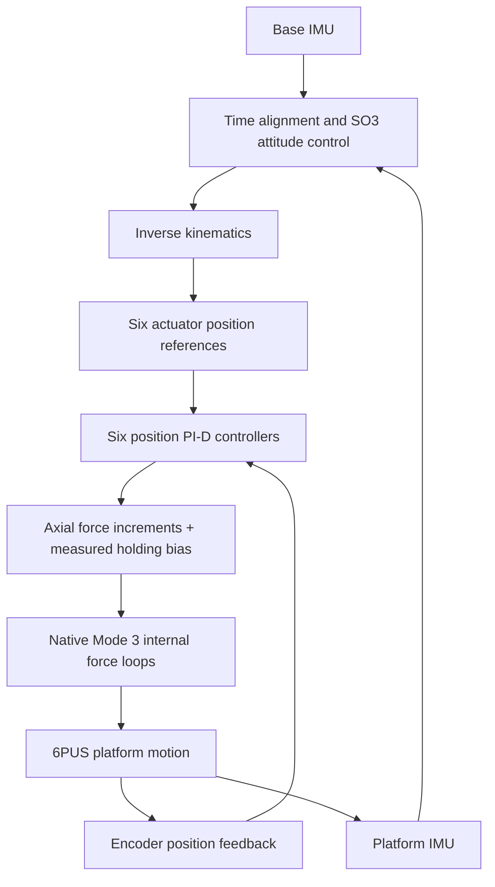

# 6PUS Bone Drill Native Force Control

> [English](README.md) | [简体中文](README_CN.md)
> **A ROS 2 framework for motion control and dual-IMU active attitude stabilization of a 6PUS parallel robot through native actuator force control.**

---

## 1. Project Overview

**6PUS Bone Drill Native Force Control** investigates motion control and active stabilization of a 6-PUS (Prismatic–Universal–Spherical) parallel manipulator / Stewart platform for orthopaedic robotics research. Six electric cylinders coordinate the platform's position and orientation. Two IMUs measure base and platform attitude so that the controller can compensate for base motion and keep the platform close to its captured world-frame reference attitude.

The project uses the actuators' **native Mode 3 force-control mode**. The host computer converts actuator position-tracking errors into axial force commands, and each actuator's internal force controller executes its command. This provides a force-driven execution layer beneath the existing attitude-control and inverse-kinematics framework.

The research question is how this cascaded architecture responds to coupled platform motion, changing loads and moving-base disturbances, and where its tracking and stabilization limits lie. The implementation builds on the independent Position and Torque projects while retaining a distinct actuator interface and control meaning.

---

## 2. Control Method

### 2.1 Native Force Control

Each electric cylinder contains a force sensor and an internal controller. In Mode 3, the host supplies an axial force target; the actuator uses its internal force feedback to regulate its drive output. The host therefore closes the mechanism-level position and attitude loops, while the actuator closes the local force loop.

This differs from sending position targets directly to a position Servo. It also differs from commanding motor-shaft torque: actuator axial force is a linear force, whereas shaft torque is a rotational quantity measured in N·m.

| Control approach | Host output to the actuator | Role of force feedback |
| --- | --- | --- |
| **Position control** | Actuator position reference | The actuator tracks position; the host coordinates platform motion through IK. |
| **Torque project's current Route A** | Position reference with force-based position correction | Measured force changes modify a position command; this is not a native motor-shaft torque interface. |
| **This project's native Force control** | Actuator axial force reference | The actuator's internal force loop executes the target, while host position feedback determines the required force increment. |

The manufacturer's force-command and feedback unit is **g**. The host performs control calculations in SI units and converts the final target to signed integer g at the device interface. This nominal conversion does not establish absolute force calibration. Product specifications and interface details are documented in the [native force hardware guide](docs/hardware/native_force.md).

### 2.2 Position PI-D to Axial Force

Inverse kinematics provides six actuator position references. For each actuator, the host compares the reference with the measured encoder position and computes an incremental force using a **position PI-D controller**:

```text
Position error:     e[i]       = q_ref[i] - q_measured[i]
Force increment:    delta_F[i] = Kp[i] * e_P[i] + I[i] - Kd[i] * v_filtered[i]
Final force target: F_ref[i]   = limit(F_hold[i] + delta_F[i])
```

Here `e_P` uses a short prediction of the measured position to account for feedback age. The integral term accumulates the measured encoder error outside its deadband. The D term uses a continuous, filtered estimate of actual actuator velocity, providing damping without differentiating reference steps. Integral state is conditionally rolled back when it would drive the final force target further into saturation.

`F_hold` is captured from the actual actuator force feedback during entry into force control. Adding the PI-D increment to this measured holding bias preserves the existing support load instead of starting every actuator from zero force. **The PI-D output is an actuator axial force increment, not a task-space Wrench or motor-shaft torque.**

This division allows the existing kinematic motion controller to operate through a native force interface without requiring a complete inverse-dynamics model. The six position loops act through a mechanically coupled platform, so their combined response must be evaluated at both actuator and platform levels. During normal three-process stabilization, the latest IK reference is used directly, without additional host reference-speed or force-slew shaping. Final force saturation and the existing physical and communication protections remain active. See the [control method](docs/control/dual_imu_position_force.md) and [force-output policy](docs/control/native_capacity.md) for details.

### 2.3 Dual-IMU Active Attitude Stabilization

The **Base IMU** measures changes in base orientation. The **Platform IMU** measures platform orientation relative to its captured reference. After time alignment and the existing mounting-frame transforms, the controller combines inverse base-rotation feedforward with platform attitude feedback on SO(3).

The active attitude controller reuses the Position project's first-order **linear active disturbance rejection control (LADRC)** for residual compensation. Feedforward supplies the geometric response to base rotation; platform feedback and LADRC correct the remaining attitude error. The resulting orientation is combined with the captured translation reference and passed through IK. Roll, Pitch and Yaw are controlled together, while the translation reference remains fixed.



The runtime starts from measured actuator positions and their reconstructed platform pose; it does not assume that all actuators are exactly at Home. Dual-IMU alignment uses host receipt times, not hardware-synchronized sensor clocks. Encoder-based forward kinematics (FK) reconstructs the platform pose for analysis, while the Platform IMU supplies the attitude feedback used by the stabilization controller.

---

## 3. System Architecture

| Component | Function |
| --- | --- |
| **6PUS mechanism and six electric cylinders** | Produce coordinated platform translation and rotation; each cylinder operates its internal force loop during active control. |
| **Base and Platform IMUs** | Measure base disturbance and platform attitude response. |
| **ROS 2 host controller** | Processes attitude, computes IK and runs six-axis position PI-D at a nominal 50 Hz. |
| **RS485/UART communication** | Sends force targets and obtains position, force, current, operating-mode and fault feedback. |

The runtime separates **attitude and reference generation**, **exclusive motor communication and local PI-D execution**, and **feedback publication and asynchronous recording** into three processes. This keeps ROS callbacks, FK computation and file writing out of the time-sensitive motor loop. The [architecture guide](docs/architecture/three_process.md) describes the implementation.

The current three-process path limits the final force target, including its holding bias, to the actuator's **±50 N product rating**, encoded within **±5098 g**. This is a **host-enforced command boundary**, not a verified firmware automatic 50 N protection mechanism. Mechanical stroke, current, communication, feedback, IMU freshness, operating mode and drive-fault checks remain in place. These boundaries do not imply that every combined pose is reachable or that the actuator can follow an arbitrary disturbance rate.

---

## 4. Current Development Status

| Capability | Current evidence and scope |
| --- | --- |
| **Native-force platform motion** | Recorded hardware experiments include a 10 mm Z round trip, positive/negative single-axis motions and a smooth six-degree-of-freedom combined trajectory. |
| **Dual-IMU active stabilization** | Implemented and operated on real hardware with three-axis base disturbances; dynamic tracking and attitude-error performance remain under investigation. |
| **Continuous operation** | A dedicated long-running entry separates control, motor communication and recording; continuous execution is supported, but long-duration stabilization performance is not yet established. |
| **Normal shutdown and Home return** | Automatic return is implemented after confirmed force-control shutdown. One recorded hardware return reached the configured Home tolerance; this does not establish every interruption or fault case. |

Recorded motion completion, software tests and offline replay answer different questions. A successful software run does not demonstrate loaded actuator dynamics, and a normal stop does not establish stabilization accuracy. FK and IMU tracking do not establish external absolute positioning accuracy. Full mechanism dynamics have not been modeled or identified, and no general stability or superiority claim is made for the native-force approach.

See the [experiment and evidence index](docs/experiments/README.md) for measured results, incomplete runs and known limitations.

---

## 5. Build and Run on the NUC

### 5.1 Environment and Build

The commands below target the existing NUC checkout on **Ubuntu 24.04 with ROS 2 Jazzy**. The runtime uses Python 3, the existing H30 IMU driver and the workspace's motor/kinematics packages, with NumPy, SciPy, PyYAML, Matplotlib and pyserial.

```bash
cd /home/lyapunov/6pus_bone_drill_force_control/bone_ws
source /opt/ros/jazzy/setup.bash
colcon build --symlink-install --packages-up-to pus6_force_control
source install/setup.bash
```

Dependency and workspace details are in the [build guide](docs/development/build.md).

### 5.2 Software Check

Check environment loading and the startup interface without starting ROS nodes, IMUs or motor communication:

```bash
bash /home/lyapunov/6pus_bone_drill_force_control/bone_ws/scripts/run_force_dual_imu_native_pid.sh --software-check
```

This checks the launcher, not physical control performance. Without hardware options, the same entry uses synthetic IMU input and Mock actuators.

### 5.3 Real-Hardware Operation and Shutdown

Start continuous Roll/Pitch/Yaw stabilization:

```bash
bash /home/lyapunov/6pus_bone_drill_force_control/bone_ws/scripts/run_force_dual_imu_native_pid.sh --hardware --hardware-qualified --start-imus
```

The script loads the ROS 2 environment, starts or reuses the required IMU inputs and runs the three-process controller. Keep the base steady during initial reference capture, and do not run another controller on the same motor bus. The program continues until an operator stop or a fault.

On a **normal Ctrl+C**, the program first stops force control and confirms six-axis Mode 0 recovery. It then uses the existing position Servo to execute a smooth return to the configured **Home reference, 1000 steps per actuator**, checks final feedback, pauses the actuators and closes communication. Home is an operating reference, not mechanical limit-seeking homing. The return is a separate position-control phase; it does not change the active stabilization method from Mode 3.

**Fault exits skip automatic Home.** The Home runner ends with a pause; the Mode 0 confirmation belongs to the preceding force-control shutdown. Detailed operating instructions and return-state limitations are in the [long-running guide](docs/operations/long_running.md) and [Home guide](docs/operations/home.md).

### 5.4 Logs and Results

Each hardware session creates a separate directory under `results/mode3_dual_imu/run_*`, printed at startup. Console logs are stored under `results/mode3_dual_imu/console/`; Mock sessions use `dry_run_*` directories. Records include dual-IMU attitude, target and FK pose, actuator references and feedback, PI-D contributions, target and measured force, current, timing and shutdown state. Home return has its own result summary.

---

## 6. Repository Layout

```text
bone_ws/
├── src/          Force control, kinematics, motor driver, IMUs and ROS interfaces
└── scripts/      Runtime launchers and experiment tools
docs/             Control principles, architecture, operations and experiment guides
results/          Recorded experiments, telemetry and analysis outputs
hardware/         Actuator manuals and mechanism references
agent_docs/       Retained stage records, frozen references and internal analyses
```

The Position and Torque repositories remain independent. Historical algorithms in this repository are reference material, not alternative descriptions of the current native-force control path.

## 7. Documentation and References

| Topic | Reference |
| --- | --- |
| Complete navigation | [Documentation index](docs/README.md) |
| Attitude, IK and position PI-D | [Dual-IMU control method](docs/control/dual_imu_position_force.md) |
| Axial force, units and output boundaries | [Native force hardware](docs/hardware/native_force.md) · [Output policy](docs/control/native_capacity.md) |
| Runtime organization | [Three-process architecture](docs/architecture/three_process.md) |
| Startup, shutdown and Home | [Long-running operation](docs/operations/long_running.md) · [Home definition and return](docs/operations/home.md) |
| Hardware results and validation scope | [Experiment index](docs/experiments/README.md) |

No repository-wide license has been established. Component-level license metadata and third-party notices retain their own scope.
