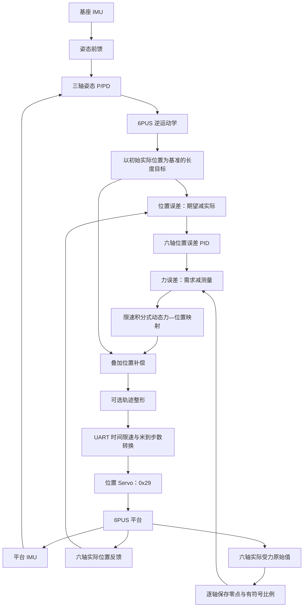

# 6PUS 力反馈辅助主动稳定控制

[English](README.md) | [简体中文](README_CN.md)

面向移动基座扰动的六电动缸 6PUS Stewart 并联机器人三轴姿态主动稳定研究。系统结合双 IMU、姿态前馈与反馈、逆运动学和电动缸实际受力变化，协调六轴运动，使末端平台尽可能保持初始世界参考姿态。

虽然仓库名为 `torque_control`，当前主要实现是**基于受力反馈与动态力—位置映射的辅助位置控制（路线 A）**。电动缸保持位置 Servo 模式（`0x25=1`），通过 `0x29` 接收位置目标。这条链路不向电机发送 N·m 轴力矩指令，也不使用厂家原生力控模式或 `0x27` 目标力接口。

## 控制架构

路线 A 保留原有基座 IMU 姿态前馈、平台 IMU 反馈、三轴姿态 P/PD 结构和 6PUS 逆运动学，在位置 Servo 前增加六轴位置误差控制器及受力反馈补偿环。



姿态层沿用原有四元数参考处理、坐标变换及 SO(3) 残差合成。基座相对旋转的逆提供几何前馈，平台姿态误差提供残差反馈。运行程序捕获首组有效双 IMU 参考，并将 IK 长度变化对齐到首组六轴实际位置，不在启动时命令机构前往模型 HOME。稳定参考是由 IMU 建立的初始姿态，并非外部测量得到的绝对姿态。

### 位置误差、受力反馈与补偿

[controller.py](bone_ws/scripts/research/force_position_control/controller.py) 对每轴 `i` 执行以下计算：

```text
e_q[i,k]       = q_d[i,k] - q[i,k]                         [m]
I[i,k]         = I[i,k-1] + e_q[i,k] * dt[i]
D[i,k]         = (e_q[i,k] - e_q[i,k-1]) / dt[i]
F_cmd[i,k]     = clip(Kp[i]*e_q[i,k] + Ki[i]*I[i,k]
                     + Kd[i]*D[i,k], -F_limit[i], F_limit[i])
F_actual[i,k]  = relative_scale[i] * (raw_0x2C[i,k] - raw_zero[i])
e_F[i,k]       = F_cmd[i,k] - F_actual[i,k]
v_corr[i,k]    = clip(A[i]*e_F[i,k], -v_limit[i], v_limit[i])
delta_q[i,k]   = clip(delta_q[i,k-1] + v_corr[i,k]*dt[i],
                     q_min[i]-q_d[i,k], q_max[i]-q_d[i,k])
q_cmd[i,k]     = q_d[i,k] + delta_q[i,k]                     [m]
```

其中，`q_d` 为对齐初始位置后的 IK 目标，`q` 为实际长度，`dt[i]` 来自各轴相邻主机接收时间戳。力需求饱和且位置误差将继续加深饱和时，PID 保持积分状态；微分项采用位置误差有限差分。首组有效反馈只初始化状态，不发出控制器位置目标。当前保存配置中，姿态控制器和六轴位置误差控制器的 `Ki=Kd=0`；实现仍保留可配置的 PID 结构。

**当前 `F_cmd`、`F_actual` 和 `e_F` 使用 `relative_raw`，不是 N。** 这里的 `F` 表示同一相对尺度下的增量受力需求、测量及误差。位置 PID 从长度误差生成需求，不输出电机力矩，也不直接写驱动寄存器。实际受力变化补充了单靠位置误差无法提供的载荷信息。保存的静止参考可能包含重力及静载，相对读数为零不代表物理受力为零。

动态映射将力误差积分为位置偏置，其状态跨采样周期保留，不是静态力—位移乘法，也不是已经实现的质量—弹簧—阻尼模型。当 `relative_scale` 与 `A` 均为正时，在需求不变的情况下，实际受力增加会使位置补偿向减小方向变化。实际物理反馈方向取决于各传感器安装及配置符号。受力反馈直接改变 `e_F` 和 `delta_q`；它通过后续实际位置变化影响位置 PID 输出，并非作为额外输入直接进入位置 PID。

修正后的目标经过可选轨迹整形，再由唯一 UART 所有者执行时间限速和步数转换。当前保存配置**关闭额外轨迹滤波**，UART 时间限速仍生效。[ros_node.py](bone_ws/scripts/research/force_position_control/ros_node.py) 将来自同组状态帧的位置与受力配对；六帧依次接收，不代表设备同时采样。[uart_driver.py](bone_ws/scripts/research/force_position_control/uart_driver.py) 在位置写入前统一检查六轴目标，运动写入不自动重试。

### 与原位置控制方案的区别

| 环节 | 对照组：双 IMU 前馈 + Classical P/PD | 实验组：路线 A |
| --- | --- | --- |
| 姿态与 IK | 基座前馈、平台姿态反馈、三轴 P/PD、IK | 保留原有上层结构 |
| 执行器反馈 | 位置 Servo 跟踪长度目标 | 位置误差生成相对受力需求，实际受力变化闭合新增补偿环 |
| 位置目标 | 原长度目标 | 原目标叠加动态受力补偿 |
| 驱动接口 | 位置 Servo | 同一位置 Servo，`0x29` |

主要对照是独立[原位置控制仓库](https://github.com/LiorenYuhang/6pus-bone-drill-position-control)中的 [J14 Feedforward + Classical P/PD](https://github.com/LiorenYuhang/6pus-bone-drill-position-control/blob/main/bone_ws/scripts/run_j14_demo_feedforward_pd.sh)。路线 A 的独立运行程序不依赖 J14 进程。仓库保留的历史算法和实验不等于当前主控制链，也不能作为这条链路性能改善的证据。

## 硬件、单位与配置

| 项目 | 当前实现或设置 |
| --- | --- |
| 机构 | 六轴 6PUS 并联平台，执行三轴姿态稳定任务 |
| 传感器 | 基座及平台 IMU；六轴位置、原始受力量和 ADC 反馈 |
| 驱动 | 唯一 UART 所有者；位置模式 `0x25=1`；`0x29` 位置目标 |
| 位置范围 | 0–2000 steps，与实际驱动回读限位及原有几何约束取交集 |
| 换算 | 1 step = 0.025 mm = 0.000025 m；40 steps/mm |
| HOME | 几何配置当前定义为六轴各 1000 steps |
| 软件速度上限 | 六轴均为 17 mm/s，依据 LAF50-024D 厂家标称**空载**速度设置；不代表已测得的负载最大速度或平台运动速度 |
| 控制周期 | 标称 20 ms，实际反馈间隔另行检查 |
| 受力表示 | 逐轴清零的 `relative_raw`，尚未完成 N 单位的绝对力标定 |
| 额外轨迹滤波 | 保存配置中关闭，保留 UART 速度限制 |

[几何配置](bone_ws/src/pus6_kinematics/config/6pus_geometry.yaml)使用 `q[i] = 0.05 + (steps[i]-1000)*0.000025` m 将原始步数转换为 IK 长度坐标。因此，0–2000 steps 对应相对原始零点的 0–50 mm 位移，以及模型坐标中的 0.025–0.075 m；两者是不同参考，不是两种电缸行程。

新增受力反馈不改变机构、几何或可用工作空间。当前补偿没有人为设置的 50 μm 上限，其允许偏置由最终位置边界确定。真实机械、运动学及驱动保护仍然适用；软件命令范围不代表任意六轴组合都满足运动学约束。

运行程序加载 [calibrated_config.json](bone_ws/scripts/research/force_position_control/calibrated_config.json)。其中保存六轴独立的 `raw_zero` 和有符号 `relative_scale`，启动不自动重新清零。位置 PID 的 `kp/ki/kd` 单位分别为 relative/m、relative/(m·s)、relative·s/m；`force_limit_relative` 限制需求，`admittance_m_per_relative_s` 为映射系数 `A`，单位 m/(relative·s)，`correction_rate_m_s` 限制位置补偿速度。具体数值以配置文件为准。保存的符号及比例不表示已完成物理方向或绝对力标定。实现也接受另行完成标定的 N 配置，但那不是当前相对模式。

## NUC 构建与运行

以下命令面向当前安装 ROS 2 Jazzy 的 Ubuntu NUC 工作目录。本次仅发布 README，不同时发布尚未提交的本地运行代码或本地已有启动脚本，因此不表示全新 GitHub 克隆已包含这些未提交文件。更多操作细节见[硬件与配置指南](docs/research/6PUS_FORCE_POSITION_HARDWARE.md)。

需要时构建独立工作区：

```bash
cd /home/lyapunov/6pus_bone_drill_torque_control/bone_ws
source /opt/ros/jazzy/setup.bash
colcon --log-base log/force_position build --base-paths src \
  --build-base build/force_position --install-base install/force_position
```

启动真实路线 A：

```bash
cd /home/lyapunov/6pus_bone_drill_torque_control
bash bone_ws/scripts/run_force_position_feedback_pid.sh
```

脚本加载 Jazzy 和本工作区 `install/force_position/local_setup.bash`，通过 `/usr/bin/python3` 运行源码程序并加载保存的配置，启动双 IMU 输入和独立 UART 所有者。它允许在当前测量位置选择位置 Servo，不自动回 HOME，也不增加启动 HOME 运动。不要同时运行其他占用电机 UART 的进程。可选参数 `--duration 10` 表示十秒后正常结束。

### 实时监控与日志

另开终端，加载相同环境后查看所需话题：

```bash
cd /home/lyapunov/6pus_bone_drill_torque_control
source /opt/ros/jazzy/setup.bash
source bone_ws/install/force_position/local_setup.bash
ros2 topic echo --full-length /force_position/attitude
# 以下命令分别运行，或在其他终端运行：
ros2 topic echo /force_position/position_feedback
ros2 topic echo /force_position/relative_force
ros2 topic echo /force_position/raw_force_feedback
ros2 topic echo --full-length /research_force_position/diagnostics
ros2 topic echo --full-length /force_position/uart_state
```

姿态诊断的 `base_relative_rpy_rad` 和 `platform_relative_rpy_rad` 按 Roll/Pitch/Yaw 排列，单位 rad，均相对捕获的参考姿态。控制诊断包括 `desired_m`、`actual_m`、`error_m`、`force_cmd_relative`、`force_actual_relative`、`force_error_relative`、`correction_m`、`position_command_m` 和 `shaped_command_m`。UART 状态提供实际反馈和故障码；日志 `position_acknowledged` 记录已发送步数目标及应答。

日志保存在 `results/force_position/<时间戳>/`，启动时打印为 `LOG_DIR`。每次运行包含 `config.json`、`telemetry.jsonl`、`h30_base.log` 和 `h30_platform.log`。受力量保留 `relative_raw` 标识；主机接收时间不能解释为设备同步采样时间。

### 正常退出与故障

在运行终端按 Ctrl+C，等待指定运行时间结束，或发布：

```bash
ros2 topic pub --once -w 1 /force_position/stop std_msgs/msg/Empty '{}'
```

正常退出时停止当前控制流，读取六轴实际位置，通过原位置 Servo 执行协调的五次平滑 HOME 轨迹。返回期间 UART 通信和反馈持续运行。最终 HOME 目标发出后，需连续两次状态查询确认六轴全部进入现有 ±5 steps 的 HOME 容差，再逐轴发送一次暂停命令（`0x1A=1`）并检查应答，最后关闭通信并退出。日志顺序为 `home_started → home_confirmed → pause_complete → uart_stopped`。

通信故障、位置反馈无效或过期、驱动故障时跳过或中止 HOME，转入现有故障暂停路径。缺失暂停应答会报告失败，不视为成功停止。退出 HOME/暂停流程已通过 Mock 软件测试；这不等于真机返回精度或停止性能已验证。

## 研究评价

研究目标是判断实际受力变化能否改善原位置控制方案的三轴姿态稳定。对照实验包括静态保持、Roll/Pitch/Yaw 单轴扰动、两轴与三轴组合扰动以及连续基座扰动。通过实际记录的基座 IMU 曲线判断输入可比性，不默认手动扰动完全一致。

逐轴报告末端姿态误差 RMS、Peak、P95，采用明确判据的恢复时间，以及基座扰动向末端的传递情况。结合六轴位置误差、相对受力、PID 需求、力误差、补偿量、最终命令、实际位置及饱和/保护事件解释响应。论文预期形成控制框图与模型、可比基座扰动下的 Base/Platform 曲线、相对受力及位置补偿曲线、定量对比，以及补偿机理、适用条件和性能边界分析。改善结论必须来自真实对比数据，不能因增加反馈环就预设有效。

## 代码入口

- [双 IMU 姿态处理与 IK](bone_ws/scripts/research/force_torque_control/imu_chain.py)。
- [位置误差 PID 与动态映射](bone_ws/scripts/research/force_position_control/controller.py)。
- [ROS 反馈配对及修正目标](bone_ws/scripts/research/force_position_control/ros_node.py)。
- [独立运行程序与 UART 所有权](bone_ws/scripts/research/force_position_control/runtime.py)。
- [位置传输及正常 HOME/暂停](bone_ws/scripts/research/force_position_control/uart_driver.py)。
- [硬件运行与标定指南](docs/research/6PUS_FORCE_POSITION_HARDWARE.md)。

原位置控制仓库保持独立。本文档不修改其算法或研究运行程序。仓库尚未确立统一许可证，各组件原有声明仍然适用。
