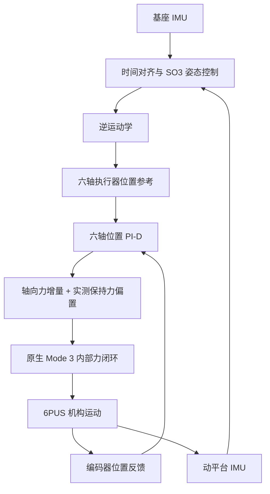

# 6PUS 骨科并联机器人原生力控

> [English](README.md) | [简体中文](README_CN.md)
> **通过电动缸原生力控实现 6PUS 并联机器人运动控制与双 IMU 主动姿态稳定的 ROS 2 框架。**

---

## 1. 项目简介

**6PUS Bone Drill Native Force Control** 面向骨科机器人研究，探索 6-PUS（移动副—万向节—球副）并联机构 / Stewart 平台的运动控制与主动姿态稳定。六个电动缸协调实现平台的位置和姿态运动；基座与动平台上的两路 IMU 提供姿态测量，使控制器能够补偿基座运动，让动平台尽量保持捕获的初始世界参考姿态。

本工程采用电动缸的**厂家原生 Mode 3 力控模式**。上位机根据执行器位置跟踪误差计算轴向力指令，由电动缸内部力控制器执行，在已有姿态控制和逆运动学框架下形成以力指令驱动运动的执行层。

研究重点是这种串级架构在机构耦合运动、载荷变化和基座扰动下的响应，以及位置跟踪和主动稳定的实际能力边界。工程复用独立 Position、Torque 项目已有的相关基础，同时保持明确不同的执行器接口与控制含义。

---

## 2. 控制方法

### 2.1 原生力控

每个电动缸内部带有力传感器和控制器。在 Mode 3 下，上位机发送轴向力目标，电动缸根据内部力反馈调节驱动输出。因此，上位机负责机构层的位置和姿态闭环，电动缸负责本地力闭环。

这种方式与直接向位置 Servo 发送位置目标不同，也与电机轴力矩控制不同：执行器轴向力是直线作用力，电机轴力矩则是以 N·m 表示的转动量。

| 控制方式 | 上位机发送给执行器的目标 | 力反馈的作用 |
| --- | --- | --- |
| **Position 位置控制** | 执行器位置参考 | 执行器跟踪位置，上位机通过 IK 协调平台运动。 |
| **Torque 工程当前路线 A** | 叠加受力补偿后的位置参考 | 实际受力变化用于修正位置指令，不是原生电机轴力矩接口。 |
| **本工程原生 Force 控制** | 执行器轴向力参考 | 电动缸内部力闭环执行目标，上位机根据位置反馈确定所需力增量。 |

厂家力指令和反馈的单位为 **g**。上位机使用 SI 单位计算，在设备接口处将最终目标转换为有符号整数 g。名义单位换算不等于完成绝对力标定。产品规格与接口说明见[原生力控硬件文档](docs/hardware/native_force.md)。

### 2.2 位置 PI-D 到轴向力

逆运动学生成六轴执行器位置参考。对每个执行器，上位机比较参考位置和真实编码器位置，通过**位置 PI-D 控制器**计算力增量：

```text
位置误差：   e[i]       = q_ref[i] - q_measured[i]
力增量：     delta_F[i] = Kp[i] * e_P[i] + I[i] - Kd[i] * v_filtered[i]
最终目标力： F_ref[i]   = limit(F_hold[i] + delta_F[i])
```

其中，P 项误差 `e_P` 使用短时位置预测，考虑反馈龄期的影响；积分项累积死区外的真实编码器位置误差；D 项使用连续估计、经过滤波的实际执行器速度，提供阻尼，避免对参考位置突变直接求导。最终目标力饱和时，如果本轮积分会进一步加深饱和，控制器会条件回退积分状态。

`F_hold` 是进入力控时从实际力反馈捕获的保持力偏置。将 PI-D 增量叠加到这个偏置上，可以保留机构原有的支撑载荷，避免六个执行器从零力开始接管。**PI-D 输出是执行器轴向力增量，不是任务空间 Wrench，也不是电机轴力矩。**

这种分工使已有的运动学运动控制器可以通过原生力接口驱动机构，不要求先建立完整逆动力学模型。六个位置环通过并联机构相互耦合，因此需要同时从执行器和平台两个层面评价整体响应。正常三进程主动稳定直接使用最新 IK 参考，不额外进行上位机位置参考限速或力指令斜率整形；最终力饱和与既有物理、通信保护继续生效。详细实现见[控制方法](docs/control/dual_imu_position_force.md)与[力输出策略](docs/control/native_capacity.md)。

### 2.3 双 IMU 主动姿态稳定

**Base IMU** 测量基座姿态变化，**Platform IMU** 测量动平台相对于捕获参考的姿态。两路姿态经过时间对齐和既有安装坐标变换后，控制器在 SO(3) 上合成基座逆旋转前馈与平台姿态反馈。

主动姿态控制复用 Position 工程的一阶**线性自抗扰控制（LADRC）**进行残差补偿。前馈提供针对基座旋转的几何补偿，平台反馈与 LADRC 修正剩余姿态误差；生成的目标姿态与捕获的平移参考组合，再进入 IK。Roll、Pitch、Yaw 同时控制，平移参考保持不变。



运行程序以实际读取的六轴位置及重建平台位姿为起点，不假设六轴恰好处于 Home。双 IMU 使用主机接收时间对齐，不代表传感器硬件同步采样。编码器正运动学（FK）用于重建和分析平台位姿，Platform IMU 则提供主动稳定控制使用的姿态反馈。

---

## 3. 系统架构

| 组成 | 作用 |
| --- | --- |
| **6PUS 机构与六个电动缸** | 协调实现平台平移和旋转；主动控制期间，各电动缸执行内部力闭环。 |
| **Base / Platform 双 IMU** | 测量基座扰动和动平台姿态响应。 |
| **ROS 2 上位机控制程序** | 处理姿态、计算 IK，并以标称 50 Hz 执行六轴位置 PI-D。 |
| **RS485/UART 通信** | 发送目标力，读取位置、实际力、电流、运行模式和故障反馈。 |

运行程序将**姿态与参考生成**、**独占电机通信及本地 PI-D 执行**、**反馈发布与异步记录**分为三个进程，使 ROS 回调、FK 计算和文件记录不阻塞关键电机控制循环。具体实现见[三进程架构说明](docs/architecture/three_process.md)。

当前三进程入口依据电动缸 **±50 N 产品推拉力规格**限制包含保持力偏置的最终目标，整数编码范围为 **±5098 g**。这是**上位机软件指令边界**，不是已经验证的固件自动 50 N 保护机制。机械行程、电流、通信、反馈、IMU 时效、模式和驱动故障检查继续保留。这些边界并不代表任意组合位姿均可达，也不保证执行器能够跟随任意速度的基座扰动。

---

## 4. 当前开发状态

| 能力 | 已有证据与范围 |
| --- | --- |
| **原生力控平台运动** | 已有真实硬件记录，包括 Z 轴 10 mm 往返、单自由度正反向运动，以及平滑六自由度组合轨迹。 |
| **双 IMU 主动稳定** | 已完成实现并在真实硬件上运行三轴基座扰动实验；动态跟踪与姿态误差表现仍在研究。 |
| **持续运行** | 独立长期入口分离控制、电机通信和记录，支持持续执行；长期主动稳定性能尚未确立。 |
| **正常退出与 Home 返回** | 已实现力控确认停止后自动返回；已有一次真实返回进入配置 Home 容差的记录，不代表全部中断或故障场景都已验证。 |

真实运动完成、软件测试和离线回放分别回答不同问题。软件运行成功不能证明带载执行器动态响应，正常退出也不等于姿态稳定精度通过。FK 和 IMU 跟踪不代表外部绝对定位精度。完整机构动力学尚未完成建模或辨识，本工程不宣称原生力控具有一般稳定性保证或已经优于其他控制方式。

实测结果、未完成实验和已知局限见[实验与证据索引](docs/experiments/README.md)。

---

## 5. NUC 构建与运行

### 5.1 环境与编译

以下命令面向当前 **Ubuntu 24.04 / ROS 2 Jazzy** 的 NUC 工作目录。程序使用 Python 3、现有 H30 IMU 驱动、工作空间中的电机和运动学功能包，以及 NumPy、SciPy、PyYAML、Matplotlib 和 pyserial。

```bash
cd /home/lyapunov/6pus_bone_drill_force_control/bone_ws
source /opt/ros/jazzy/setup.bash
colcon build --symlink-install --packages-up-to pus6_force_control
source install/setup.bash
```

依赖和工作空间说明见[构建指南](docs/development/build.md)。

### 5.2 软件检查

检查环境加载与启动接口，不启动 ROS 节点、IMU 或电机通信：

```bash
bash /home/lyapunov/6pus_bone_drill_force_control/bone_ws/scripts/run_force_dual_imu_native_pid.sh --software-check
```

这项检查验证启动入口，不评价物理控制性能。同一入口不带硬件选项时使用合成 IMU 输入和 Mock 执行器。

### 5.3 真机运行与退出

启动持续 Roll/Pitch/Yaw 主动稳定：

```bash
bash /home/lyapunov/6pus_bone_drill_force_control/bone_ws/scripts/run_force_dual_imu_native_pid.sh --hardware --hardware-qualified --start-imus
```

脚本加载 ROS 2 环境，启动或复用所需双 IMU 输入，并运行三进程控制器。捕获初始参考时保持基座稳定，不要同时运行另一个占用同一电机总线的控制程序。程序持续执行，直至操作员停止或发生故障。

**正常按 Ctrl+C** 后，程序先结束力控并确认六轴恢复 Mode 0，再使用现有位置 Servo 平滑返回配置的 **Home 参考——六轴各 1000 steps**，检查最终反馈、暂停执行器并关闭通信。Home 是运行参考，不是寻找机械限位的回零。返回属于独立位置控制阶段，不改变主动稳定期间采用 Mode 3 的控制方式。

**故障退出不会自动返回 Home。** 当前 Home runner 结束时执行暂停，Mode 0 确认属于此前的力控退出阶段。详细操作与返回状态边界见[长期运行指南](docs/operations/long_running.md)和[Home 说明](docs/operations/home.md)。

### 5.4 日志与结果

每次真机运行在 `results/mode3_dual_imu/run_*` 下创建独立目录，启动时打印路径。控制台日志保存在 `results/mode3_dual_imu/console/`，Mock 运行使用 `dry_run_*` 目录。记录包含双 IMU 姿态、目标和 FK 位姿、执行器目标与反馈、PI-D 分项、目标力与实际力、电流、时序和退出状态；Home 返回另存结果摘要。

---

## 6. 工程结构

```text
bone_ws/
├── src/          Force 控制、运动学、电机驱动、IMU 与 ROS 接口
└── scripts/      运行入口与实验工具
docs/             控制原理、系统架构、操作和实验说明
results/          实验记录、遥测与分析结果
hardware/         电动缸手册与机构参考资料
agent_docs/       保留的阶段记录、冻结参考与内部分析
```

Position、Torque 工程保持独立。本仓库中的历史算法作为研究参考，不代表当前原生力控链路的其他名称或等效实现。

## 7. 文档与参考

| 主题 | 入口 |
| --- | --- |
| 完整导航 | [文档索引](docs/README.md) |
| 姿态、IK 与位置 PI-D | [双 IMU 控制方法](docs/control/dual_imu_position_force.md) |
| 轴向力、单位与输出边界 | [原生力控硬件](docs/hardware/native_force.md) · [输出策略](docs/control/native_capacity.md) |
| 运行架构 | [三进程架构](docs/architecture/three_process.md) |
| 启动、停止与 Home | [长期运行](docs/operations/long_running.md) · [Home 定义与返回](docs/operations/home.md) |
| 真机结果与验证范围 | [实验索引](docs/experiments/README.md) |

仓库尚未确立统一许可证。各组件的许可证元数据及第三方声明仍适用各自的范围。
