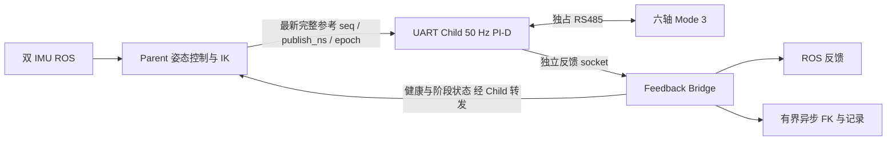

# 三进程运行与数据时序

当前入口复用本工程继承的 Position J14 `ProcessClient`、UART transport、反馈桥和进程握手，实现位姿目标生成与本地力控制解耦。双 IMU 节点在这三个进程之外。[项目总览](../../README.md)给出完整机构链路。

## 分工与通信

Parent 的 ROS 接收使用 `SingleThreadedExecutor` 工作线程；主循环生成完整 IK 六轴位置参考。UART Child 不导入 ROS、不执行 FK、不直接同步写大文件；保持当前六轴实际位置的 PI-D 状态，本地计算六轴目标力，再执行串口事务。Bridge 是反馈 socket 的唯一读取者，发布反馈，并将 FK、tracking 和串口记录交给有界异步工作队列。

IPC 为非阻塞 `AF_UNIX/SOCK_SEQPACKET`，16 KiB 消息上限、每轮至多处理 64 包。Parent 使用单槽待发参考，新参考覆盖未发旧参考；Child 采用最新完整、epoch/序号合法且未过期的向量。跨进程传递的是位置参考和诊断，不是等待依次执行的力指令 FIFO。六个力命令按串口顺序执行，不能声称它们是同时到达或设备同步采样。

## 启动与新鲜度

1. 有效双 IMU 输入、实际位置/模式/设备范围读取，建立本次初始 FK、保持偏置和 IK 参考。
2. 完成 J14 ready/start 握手，六轴 Mode 3 交接与读回确认。
3. Child 等待**确认 Mode 3 之后发布**的完整参考，沿用 200 ms 时限；交接期间入队旧参考不重标时间、不用于第一次 PI-D。
4. `reference_ready_ns` 成为固定 1 秒 `initial_hold` 的起点；每轮继续验证 IMU 和反馈，然后进入主动稳定。

Parent Lease 1000 ms、Bridge 健康 1000 ms、IK 参考新鲜度 200 ms 分别判断。Lease 只是 Parent 仍在运行的证据，不能刷新旧参考。双 IMU 各 100 ms 姿态时效和电机各轴 200 ms 反馈时效仍由原检查处理。

## 控制周期与记录

Child 以绝对 20 ms 周期调度六轴控制，实际周期和工作耗时记录；不将标称频率冒充实测频率。模式和 `0x27` 读回以约 12 次/秒分摊查询，六轴模式及六轴目标力形成一秒级轮询，每周期最多一个额外查询；保存逐次寄存器、预期值、读回值和时间，不伪装为同一时刻的完整向量。

| 字段 | 对应关系 |
|---|---|
| `command_seq` / `reference_timestamp_ns` | 本周期实际采用的 Parent 完整参考及发布时间 |
| `uart_cycle_sequence` | 本次六轴力事务序号 |
| `pid_input_cycle_seq` | PI-D 输入反馈所属事务；首次为初始化反馈 −1 |
| `pid_input_rx_ns` / `feedback_rx_ns` | 输入反馈及本次新反馈的六轴主机接收时间 |
| `reference_observed_uart_cycle_seq` | Parent 生成参考时观察到的反馈事务 |
| `mode3_start_ns` / `reference_ready_ns` | 模式确认完成与首个有效交接后参考就绪 |

异步队列满时记录丢弃数量和序号间隙，不将非关键文件记录不足新增为运动保护。`recording_complete` 与控制结果分别评价。反馈、IMU 的主机时间不等于传感器采样时钟。

## 故障与退出

Parent EOF、Lease/参考过期、Bridge 失联和原控制故障由 Child 本地处理。正常控制写流先锁止；按故障类别执行原允许的偏置恢复或直接 Pause，然后 Mode 0 实测位置重锚、逐轴确认和串口关闭。恢复过程中不能继续发正常 PI-D 目标。

若 Child 自身被强杀或主机失效，就无法保证它还能发停止帧。Parent 报告未确认退出，不另开第二个 UART writer 接管。不能以进程结束替代物理停止确认。只有正常退出且模式恢复已确认，才允许[后续独立 Servo 回 Home](../operations/home.md)。

## 源码和迁移证据

- [Parent](../../bone_ws/src/pus6_force_control/pus6_force_control/mode3_process_runtime.py)、[Child](../../bone_ws/src/pus6_force_control/pus6_force_control/mode3_process_child.py)、[Bridge](../../bone_ws/src/pus6_force_control/pus6_force_control/mode3_process_bridge.py)。
- [J14 IPC 复用层](../../bone_ws/src/pus6_motor_driver/pus6_motor_driver/j14_process_uart.py)、[异步记录](../../bone_ws/src/pus6_force_control/pus6_force_control/process_recording.py)。
- [三进程迁移、启动竞态与既有软件测试记录](../archive/force_history/three_process_migration_20261107.md)。该历史文档中的阶段命令和测试仅说明当时实现，当前运行以[操作说明](../operations/long_running.md)为准。
