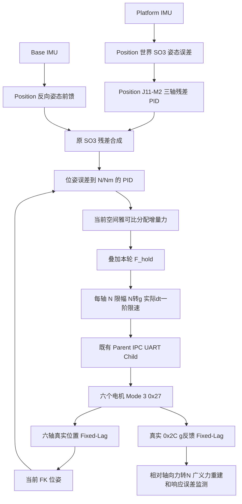

> 历史归档：原路径 `docs/force_active_stabilization.md`。正文保留当时的方案、参数及证据语境；当前原生 Mode 3 入口以[项目 README](../../../README.md)为准。历史命令不作为当前推荐启动命令。

# Force 三轴姿态主动稳定：Position PID 迁移版

本版本完成软件开发和针对性验证，尚未进行真机主动稳定实验。仅修改 Force；Position、Torque 只读，历史实验数据保留。本轮未打开串口，`hardware_write_count = 0`，未提交或推送 Git。

## 最终控制架构



姿态目标仍为保持捕获时的三轴世界姿态。平移 PID 只保持捕获时的底座相对位置，不新增 XYZ 轨迹任务。控制节点不发布电机位置目标；FK 是测量，不是位置模式命令。

此次修正移除了上一版 IMU/FK 误差加权和刚度/阻尼参数，实际迁入 Position 的姿态 PID 核心。Position 的输出是 **rad 残差**，不能直接改标为 Nm。因此保留它生成姿态参考，再以简单的位姿误差 PID 接入力执行器。这里没有引入质量模型、虚拟阻抗模型或新的 IMU 融合算法。

## Position 复用及坐标关系

实际使用的是 Position `j14_demo_controller.py` 的 `feedforward_pd` 路径：

- `h30_imu/scripts/j11_m2_pid_residual_runner.py`：`M2TaskSpaceAttitudePid`、增益/限幅结构，九个四元数和 SO(3) 数学函数，包括原残差合成函数。
- `h30_imu/config/j11_m2_pid_params.yaml`：最终保留的三轴 Classical P/PD 配置。
- 既有 Force 中来自 Position 的运动学、几何、FK 和 Fixed-Lag 数据流继续使用。

三个 PID 类放在本包 `position_attitude_pid.py`，九个纯数学函数放在 `position_attitude_math.py`，与 Position 对应源码逐个比较 AST 一致。它们是 Force 的本地副本，无 Position 路径导入依赖；没有带入旧 runner、IK 指令发布或三阶整形器。

捕获实际 FK 的 `p0/R0` 及两台 IMU 的参考四元数。以初始底座为参考世界系，沿用 Position 的机械安装变换 `C=Rz(+90°)`：

```text
q_relative = conjugate(q_initial) * q_current
R_B = C * R(q_base_relative) * C.T
R_P = R0 * C * R(q_platform_relative) * C.T
R_ff = R_B.T * R0

e_world = Log(R0 * R_P.T)
delta_phi_world = Position_M2_PID(e_world, dt)       # rad
R_command = R_B.T * Exp(delta_phi_world) * R_B * R_ff
```

`R0=I` 时就是原 Position 公式；保留实际 `R0` 避免非零初始姿态被偷偷替换成 HOME。没有对 Euler 角直接相减。Position PID 的微分由 SO(3) 误差差分、5 Hz 一阶低通计算，不另加陀螺加权阻尼。H30 已输出 rad/s，不重复转换。

| 保留的 Position 参数 | 数值 |
|---|---|
| Kp，rad/rad | `[0.05,0.05,0.025]` |
| Ki，1/s | `[0,0,0]` |
| Kd，s | `[0,0.0015,0.0015]` |
| 微分低通 | 5 Hz |
| 每轴残差角限幅 | 0.5°，配置中为 rad |
| 积分状态限幅 | `[2,2,4]` °·s，配置中为 rad·s |
| PID dt 下限/上限 | 0.001/0.1 s，保留原 Position 行为 |

## 位姿 PID 与 Mode 3 力指令

FK 给出同一同步时刻的 `p_fk/R_fk`，在底座系计算：

```text
e_pose = [p0-p_fk, Log(R_command * R_fk.T)]             # m, rad
Delta_W_requested = Kp_pose*e_pose + I_pose + Kd_pose*LPF(d(e_pose)/dt)
I_pose = integral(Ki_pose * e_pose * dt)                 # N, Nm
Delta_W = task_limits_and_first_order_rate(Delta_W_requested)
Delta_f_n = solve(J_spatial.T, Delta_W)
f_command_n = F_hold_n + Delta_f_n
```

位姿 PID 输出为 `[Fx,Fy,Fz,Mx,My,Mz]`，单位 N/Nm，作用点和轴序沿用原雅可比。没有再叠加参考广义力。默认位姿 PID 为 P，保留 I/D 配置、微分滤波和积分限幅；P 增益前三轴是 N/m、后三轴是 Nm/rad，I=P/s、D=P·s。它们是新执行接口的增益，不能因为 Position 已验证就认定这些 SI 增益也已验证。

Force 当前软件例值：`pose_kp=[10,10,10,0.2,0.2,0.2]`，`pose_ki=pose_kd=0`。任务增量限幅沿用上一版每轴 ±1 N、±0.1 Nm；广义力变化率仍为 `[1,1,1,0.1,0.1,0.1]` N/s、Nm/s。旧 Z 轴力 PID 和它的 ±10 N 参数保持原样，不参与本节点。

积分防饱和覆盖位姿 PID 输出限幅、广义力限速和既有执行器绝对力/目标限速。下游受限时回退相应积分增量，并冻结本周期上层角残差积分；默认两级 Ki 均为零。禁用、故障及重新捕获清除两个 PID 状态，**不会清除 F_hold**。

最终仍用现有驱动处理：

```text
F_hold + Delta_f_n
 -> 每轴绝对目标力限幅 ±14.709975 N
 -> force_units.py 的 N→有符号 g
 -> 实际 monotonic dt 一阶限速，500 g/s
 -> int16 编码 -> 原 UART 单一所有者 -> 0x27
```

Torque 的 `SixAxisPositionDrive.command()` 公式继续由现有 `PhysicalTimeRateLimiter` 和力驱动复用：`next=old+clip(target-old, ±rate*actual_dt)`。不使用名义周期代替实际 dt，不引入三阶整形器。0.017 m/s 是位置参考速度，未改成力变化率；本节点不发位置轨迹。

## 位置、姿态和力反馈各自的作用

- Base IMU：反向姿态几何前馈。
- Platform IMU：世界三轴姿态误差，输入原 Position 残差 PID。
- 六轴实际位置：FK 位姿、位姿 PID 误差、当前雅可比和原 6 steps/0.15 mm 行程保护。
- 六轴真实力：原生电机内部力环、上层相对力/广义力重建、有效性检查与控制响应监测。

```text
measured_delta_wrench = J_spatial.T * g_to_n(raw_g - hold_g)
response_error = commanded_delta_wrench - measured_delta_wrench
```

力反馈不是命令值，也不是把 FK 误差伪装成测量力。上层不额外叠加旧 Z 力 PID，避免未经验证的多重力环。重建量含支撑、惯性和摩擦等影响，不能直接称为独立测得的末端外部接触力。

F_hold 来自 UART Child 本轮实读 0x2C、同帧 Mode 3 交接及读回确认，通过现有 IPC/Bridge 元数据传入。正负号保留，不取绝对值、不默认六轴零、不重复 Tare、不重复软件减基线或叠加重力补偿。

## ROS2 使用及保持行为

入口、话题和已有三进程 UART 架构保持：

| 接口 | 用途 |
|---|---|
| `/pus6/imu_base/data`、`/pus6/imu_platform/data` | 原 H30 Imu 输入 |
| `/pus6/joint_feedback/timed` | 实际 q/f、逐轴时刻、模式及保持参考 |
| `/force_active_stabilization/enable` | SetBool，捕获参考并启用/停发正常指令 |
| `/pus6/force_control/axial_forces_dry_run` | 默认软件输出，与硬件命令隔离 |
| `/pus6/command_axial_forces` | 仅独立写入授权、资格条件满足后的真实 SI 力命令 |
| `/pus6/force_control/reconstructed_wrench` | 实际相对广义力 |
| `/pus6/force_control/diagnostics` | 两级 PID、SO(3) 参考、真实/预测广义力及响应误差 |

q/f 沿用 `FixedLagJointSynchronizer`。两台 IMU 在相同 `measurement_ns` 插值，不外推；H30 部分姿态/gyro 消息按 covariance 标记独立保存接收时间，姿态更新不刷新旧 gyro 年龄。这里仍是主机接收时间对齐，不声称硬件采样时钟同步。重复反馈不重复执行 PID。

配置：`bone_ws/src/pus6_force_control/config/active_stabilization.yaml`。旧 `attitude_stiffness_*`、`position_stiffness_*`、阻尼和 `imu_error_weight` 参数已移除；使用当前 PID 参数文件。

```bash
source /opt/ros/jazzy/setup.bash
source /home/lyapunov/6pus_bone_drill_force_control/bone_ws/install/setup.bash
ros2 launch pus6_force_control active_stabilization.launch.py
```

launch 只启动控制器，不启动 UART/IMU 串口或旧 Position Demo。默认 dry_run=true，写入授权/硬件资格=false，控制未启用。已有软件输入时可使用：

```bash
ros2 service call /force_active_stabilization/enable std_srvs/srv/SetBool '{data: true}'
```

停用为 data:false。服务不选择模式、不执行 Tare、不授权硬件写入。真实 UART 所有者仍需现有 `control_mode=force` 分支及独立授权配置；不要让旧 Z PID 同时争用力命令话题。

正常执行、禁用和控制节点故障均不发送 Mode 0、位置命令或自动 Pause。停发后原 Child 的超时策略经既有 g/s 限速回到 F_hold，保持 Mode 3。**停发不是物理急停，也不证明平台静止。** 保留原模式只读复核、首次交接部分失败恢复及 Mode 0 同帧重锚定维护接口；主动稳定节点不调用位置模式来代替控制。

## 本次文件与验证

本次新增：

- `pus6_force_control/position_attitude_pid.py`：Position M2 原 PID 核心。
- `test/test_active_stabilization_pid.py`：PID 计算、单位衔接和参考组成测试。

本次修改（均在 Force）：

- `pus6_force_control/position_attitude_math.py`：补入原 SO(3) 残差合成及其四元数转换函数。
- `pus6_force_control/active_stabilization.py`：替换加权/阻抗路径为 Position 姿态 PID＋FK 位姿 PID，抗积分饱和。
- `pus6_force_control/active_stabilization_node.py`：输出衔接、下游限幅反馈、停用/故障清理 PID 状态。
- `config/active_stabilization.yaml`：保留原角度 PID 参数，明确独立 SI 位姿 PID 参数。
- `test/test_active_stabilization.py`：替换原阻尼模型测试，保留 ROS/Fixed-Lag/Mode 3 检查。
- `pus6_force_control/force_pipeline.py`：仅更新广义力入口说明，计算和编码未改。
- 本文。

59 项针对性测试通过：40 项主动稳定数值/ROS/FakeBus 用例，以及 9 项既有保持交接、10 项雅可比独立有限差分/虚功/旧 PID 回归。覆盖三轴方向、Base 单独前馈、Platform 单独反馈、非零初始姿态及不交换旋转合成、原 PID 微分与限幅、位姿 PID 单位、防饱和、保持力不被覆盖、实际力广义力重建、真实 ROS dry-run 收发、部分切换恢复及模式丢失处理。测试没有打开真实串口；FakeBus 的帧不是实机执行结果。

`pus6_force_control` 受影响包构建成功。原协议、Tare、异步完成应答、Mode 3 同帧交接、单位模块、运动学、雅可比、力分配、单一所有者和历史实验未修改。

## 距离真机主动稳定实验

软件已具备三轴姿态 PID 到 Mode 3 力执行链。下一步是沿用现有现场条件和保护，以小姿态扰动检验新位姿→力 PID 的 SI 增益、实际方向和原生力环响应，再整定这些新接口增益。Position 的姿态 PID 已复用，但原位置执行器闭环换成力执行器后，不能宣称具有相同带宽或稳定效果。

IMU 安装变换和六轴方向沿用原定义，后续需以实际响应核对；Stage 3C 中 ID2/ID3 的物理响应差异没有因本次软件修改而得到实测解释。保留现有行程保护和力限幅，不以 Tare 消除机械载荷解释问题。不需要重新探索已验证的 Tare 或交接协议。本阶段没有真机主动稳定性能结论。
