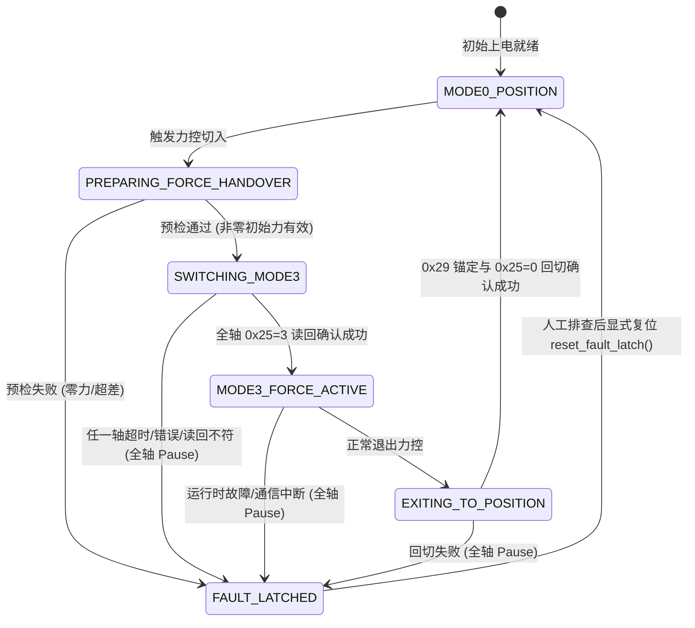

> 历史归档：原路径 `docs/force_control_stage3b1_1_safety_handover.md`。正文保留当时的方案、参数及证据语境；当前原生 Mode 3 入口以[项目 README](../../../README.md)为准。历史命令不作为当前推荐启动命令。

# Stage 3B-1.1：力控模式安全交接机制实施报告

日期：2026-11-03（Asia/Shanghai）。
工程：`/home/lyapunov/6pus_bone_drill_force_control`。

> **Stage 3B-1.2 更新（2026-11-03）**：本文保留为历史阶段记录，其中“部分切换失败/位置回切失败自动全轴 Pause”的策略已被替换。当前实现停止后续切换，仅对已确认 Mode 3 的轴执行当前位置重锚定并回切 Mode 0；恢复失败锁存故障、报告逐轴实际模式，不自动 Pause。当前交接基线重新读取 `0x2C`，不默认采用本文历史数值。详见 [Stage 3B-1.2 说明](force_control_stage3b1_2_handover_recovery.md)。

## 概述与阶段定位

在 Stage 3B-1 中，完成了真实六轴微型伺服电缸在 Mode 0（位置控制模式）下的 5 轮只读数据采集，测得真实静态载荷基线（ID1: 3754 gf / 36.81 N, ID2: -687 gf / -6.73 N, ID3: -6176 gf / -60.57 N, ID4: 793 gf / 7.78 N, ID5: -671 gf / -6.58 N, ID6: -6994 gf / -68.59 N）。

**本阶段核心目标**：针对当前机构受载明显、六轴总线非原子切换、厂家协议未证实项（负目标力范围、Pause 保持行为、受载回切时序）等安全风险，在 Force 工程中完成力控模式安全交接机制的软件重构与离线验证。

**安全红线承诺**：
- **绝对零真机写入**：不打开物理串口 `/dev/ttyUSB0`，不向真实电机发送任何写命令（0x25、0x27、0x29、0x1A）、模式切换或运动指令。
- **参考工程只读**：不修改 Position 和 Torque 参考工程。
- **单所有者架构**：保留 UART Child 唯一串口所有者模型。
- **未证实项显式标注**：手册未定义或硬件未验证项全部明确标注为 `UNVERIFIED`，采用最保守防御策略。

---

## 一、硬件写入授权三门禁与 dry-run 彻底隔离

### 1. 原有代码安全隐患分析
在 Stage 3A 与初期代码审查中，发现了两处关键的写入授权穿透漏洞：
1. **`dry_run` 穿透物理串口**：在 `ServoCore.cycle()` 原有逻辑中，当 `is_dry_run=True` 时跳过了 `hardware_write_enabled` 与 `is_hardware_qualified` 的异常检查，随后在未判定 dry-run 的情况下直接调用了 `self.writer.send_force_cycle(dispatched)`。在 `hardware_mode='active'` 时，这会导致真实物理总线下发写入报文，dry-run 失去了隔离保护作用。
2. **初始化提前下发硬件写**：在 `ServoCore.initialize()` 中，一旦 `control_mode == 'force'`，直接调用了 `writer.configure_force_mode()`。这一操作发生在任何周期性门禁检查之前，如果在 active 模式且未获得显式授权时启动 Child，初始化阶段就会向总线发出写入帧。

### 2. 三门禁独立管理模型
在 `ServoCore` 中重构并严格实现了三门禁独立判定逻辑：
- `dry_run`（布尔值）：仿真/空跑模式。当其为 `True` 时，**绝对禁止**向物理总线写入任何数据，所有底层驱动操作重定向至虚拟遥测回路。
- `hardware_write_enabled`（布尔值）：用户/上层显式授权标记。默认必须为 `False`。
- `is_hardware_qualified`（布尔值）：硬件前置安全资格（如零位对齐、传感器在线、姿态安全等）确认标记。默认必须为 `False`。

```python
def can_write_hardware(self) -> bool:
    """Independently verifies 3-way hardware write authorization conditions."""
    if self.fault_latched or self.fault is not None:
        return False
    if self.config.get('dry_run', False):
        return False
    if self.config.get('hardware_mode') == 'mock':
        return True
    if self.config.get('hardware_mode') == 'active':
        return bool(
            self.config.get('hardware_write_enabled', False)
            and self.config.get('is_hardware_qualified', False)
        )
    return False
```

### 3. dry-run 彻底隔离与虚拟遥测实现
在 `dry_run=True` 时：
1. `initialize()` 跳过物理写操作，将状态置为 `MODE3_FORCE_ACTIVE`，并记录初始力；
2. `cycle()` 中通过 `_simulate_dry_run_audit()` 构建完全符合 `SixAxisCycleAudit` 接口规范的虚拟审计数据（包含模拟 `StatusFeedback`、虚拟 `SixAxisTxRecord`，写入字节数严格置 0）；
3. 彻底跳过 `writer.send_force_cycle()` 与 `writer.send_cycle()`；
4. 遥测反馈包中附带 `dry_run=True` 与当前 `handover_state`。
测试证实，在 dry-run 下向总线发送的物理写报文数量恒为 0。

### 4. 故障锁存机制 (Fault Latching)
任何异常（总线通信超时、协议解析错误、状态机切换失败、非法目标力超限等）触发 `stop(reason)` 时：
1. 立即置位 `self.fault_latched = True`；
2. 状态机迁移至 `ForceHandoverState.FAULT_LATCHED`；
3. 后续周期调用 `cycle()` 时在最前端拦截并抛出 `RuntimeError("Command cycle rejected: fault is latched")`；
4. 拒绝任何新的力控命令输入，直到操作员显式调用 `reset_fault_latch()`。

---

## 二、六轴 Mode 3 安全切入状态机

### 1. 物理非原子性与 RS-485 串行调度
6PUS 并联机构的 6 个电机挂载在半双工 RS-485 总线上。厂家手册明确每个寄存器请求必须按从机 ID 逐一发送，不存在全机构硬件原子级同步切换机制（广播地址 0xFF 不返回响应，无法验证执行结果，严禁用于安全切换）。
因此，六轴切换必然经历一个**微小的跨轴异构/混合模式阶段**（先发轴已处于 Mode 3，后发轴仍处于 Mode 0）。

### 2. 状态机流转设计
定义了 `ForceHandoverState` 枚举并维护完整的状态迁移：



### 3. 0x25 读回硬确认原则
在 `j7_six_axis_servo_transport.py` 的 `configure_force_mode()` 中：
- 向电机发送连续写 `[0x25=3, 0x26=0, 0x27=F_init]` 后，电机返回写入 ACK；
- **但写入 ACK 仅代表从机通信芯片接收了数据，不代表电机核心固件已完成内部模式校验并进入闭环控制**；
- 因此，传输层紧接着发送 0x31 读请求读取 0x25 寄存器；
- 只有实测读回值严格等于 `3`（`MODE_FORCE`），才确认该轴切入成功。

### 4. 部分轴切入失败处置机制
若在切换 ID$k$（$1 \le k \le 6$）时出现应答超时、校验错误或 0x25 读回不为 3：
1. **立即中止后续切换**：绝不继续对 ID$k+1 \dots 6$ 下发切换指令。
2. **已切入轴处理策略**：
   - 严禁盲目自动回写 Mode 0：若通信链路本身出现故障或受阻，盲目全轴回写可能导致不可预测的指令交织和突跳。
   - 立即调用 `stop_adapter("force_mode_startup_failure")` 向全轴下发 `0x1A=1`（Pause 暂停）；
   - 状态迁移至 `FAULT_LATCHED`，记录故障发生轴与当前各轴模式分布；
   - 维持故障锁存，等待现场操作人员按照机械承载保护方案人工介入。

---

## 三、初始目标力交接与静载荷保持

### 1. 0 gf 切入的严重安全危害
Stage 3B-1 实测数据表明：
- 支链 1 承受拉力约 +36.8 N（+3754 gf）；
- 支链 3 承受压力约 -60.6 N（-6176 gf）；
- 支链 6 承受压力约 -68.6 N（-6994 gf）。
整个动平台由六轴支链在空间几何约束下共同平衡机构自重及外载。
**若以 0 gf 初始力切入力控，电缸将立即卸载原有的支撑载荷，导致动平台失稳下坠或引发剧烈机械冲击。**

### 2. 初始目标力向量注入机制
1. `configure_force_mode()` 升级为接受 6 轴独立序列 `initial_forces_g: Sequence[int]`。
2. 依据厂家手册第 23 页推荐的方法二，采用从 0x25 连续写 3 个寄存器：`[3, 0, initial_forces_g[i]]`。将模式切换与初始目标力同报文下发，消除“先切力控模式再慢慢发目标力”导致的零力空档。
3. `validate_initial_handover_forces()` 强制校验：
   - 当系统存在显著静态载荷（任一轴幅值 > 100 gf）时，如果传入全零向量 `[0, 0, 0, 0, 0, 0]`，抛出 `SafetyViolation` 拦截切入；
   - 校验各轴初始力与静态基线 `STAGE3B1_STATIC_BASELINE_GF` 的偏差，超限（`handover_tolerance_gf`）直接拒绝。

### 3. 底层静载荷维持策略
在进入 Mode 3 后、上层 ROS 2 动态力控指令到达前（或上层节点启动建立阶段）：
- 底层 `ServoCore` 将 `last_command_force_gf` 锚定为经过验证的初始静态载荷向量；
- `CommandState.candidate_force()` 在无新指令输入时，维持该静态支撑力；
- 若上层通信超时，`candidate_force()` 依据配置回退至 `fallback_force_n`（静态支撑力），而不是突降至 0 gf。

### 4. 目标力方向、符号与单位换算
- **物理换算**：$1\text{ gf} = 0.00980665\text{ N}$，$F_{gf} = \frac{F_N}{\text{direction} \times 0.00980665}$。
- **寄存器编码**：0x27 目标力为 2 字节小端序。代码中采用标准的 16 位有符号补码进行编解码（`encode_signed_i16_to_u16` / `decode_u16_to_signed_i16`）。
- **传感器与目标力符号一致性**：电缸内置力传感器反馈 0x2C 在手册中为有符号 16 位。实测中受拉为正，受压为负。目标力 0x27 严格遵循与反馈相同的符号映射定义。
- **未证实项标记 (UNVERIFIED)**：
  > [!WARNING]
  > 厂家手册第 12 页仅注明 0x27 目标力单位为 g，未给出负目标力（反向拉力/压力）的额定范围及固件解释说明。当前软件在配置中保留 `allow_negative_forces` 保护开关。

---

## 四、安全退出与模式回切机制

### 1. 动态位置突跳风险
在 Mode 3 力控运行过程中，电缸根据受力动态微调位置，机构的实际位置已经偏离切入时的坐标。
若直接写入 `0x25=0`（定位模式），由于电机内部目标位置寄存器 0x29 仍保留着切入力控前的旧值，电机会以默认速度疯狂追踪旧目标位置，引发灾难性运动突跳！

### 2. 当前位置锚定回切时序 (Position Re-anchoring)
在 `j7_six_axis_servo_transport.py` 中实现了 `transition_to_position_mode()`，规范退出时序：
1. **读取实际位置**：通过 0x31 读取六轴当前实际位置寄存器 0x2A；
2. **位置锚定**：将实际位置写入 0x29（目标位置寄存器）；
3. **切换定位模式**：下发 0x25=0（Mode 0）；
4. **读回核验**：通过 0x31 读回 0x25，确保全部返回 Mode 0。

测试表明，执行退出后各轴的 0x29 目标位置与其实测位置完全一致，消除了位置模式追踪偏差导致的突跳。

### 3. Pause (0x1A=1) 与模式回切的对比
| 特性 | Pause 暂停 (0x1A=1) | 模式回切 (Mode 3 -> Mode 0) |
|---|---|---|
| **适用场景** | 紧急停机、通信丢失、总线超时、故障闭锁 | 正常、有序、计划内力控任务结束 |
| **执行机制** | 下发 0x1A=1 触发驱动器硬件减速停止 | 0x2A 读取 -> 0x29 锚定 -> 0x25=0 切换 |
| **负载保持能力** | **UNVERIFIED**（厂家手册未说明 Mode 3 Pause 后的掉电/闭环状态） | 进入位置闭环伺服刚度保持 |
| **恢复方式** | 需人工解除或重新配置 | 处于正常 Mode 0，可直接接受位置规划 |

---

## 五、力传感器基线与零点管理规范

为了杜绝工程中把“当前受力”、“零位”和“标定”混为一谈的概念混乱，规范了以下 5 个物理量及其命名契约：

| 规范术语 | 对应变量/字段 | 物理含义与来源 |
|---|---|---|
| **传感器原始读数** | `raw_sensor_g` | 电缸内置应变片传感器的 0x2C 寄存器原始有符号读数（未做任何软件扣除，单位 g）。 |
| **静态装配载荷基线** | `static_assembly_load_g` | Stage 3B-1 实测测得的静态平衡力（由机构重力分布、几何约束和铰链刚度产生，单位 g）。 |
| **传感器真实零点** | `sensor_zero_g` | 传感器在未安装、完全脱开无外力下的固有电气零偏（Tare/Bias，单位 g）。 |
| **静态重力/支撑补偿力** | `gravity_support_comp_g` | 理论刚体动力学模型或校准查找表给出的、在当前位姿下抵消动平台自重所需的支链推力（单位 g）。 |
| **控制器期望末端力** | `controller_desired_force_n` | 上层力控算法（如末端阻抗/导纳控制）输出的期望任务空间交互力（单位 N）。 |

在 `pus6_motor_driver/safety.py` 中封装了 `ForceBaselineManager`，统一管理各分量的计算与校验。

---

## 六、离线 FakeBus 单元测试套件与执行结果

在 `bone_ws/src/pus6_motor_driver/test/test_stage3b1_1_safety_handover.py` 中编写了 9 个专项离线单元测试，覆盖了全部设计场景：

| 测试用例名称 | 验证内容 | 结果 |
|---|---|:---:|
| `test_three_way_authorization_gating` | 验证默认禁止、未授权拒绝、缺失资质拒绝及全满足授权的逻辑门禁。 | **PASSED** |
| `test_dry_run_complete_isolation` | 验证在 active+dry-run 下执行力控循环，向底座发送物理帧数量为 0。 | **PASSED** |
| `test_mode3_entry_state_machine_full_flow` | 验证预检 -> 初始力写入 -> 逐轴切换 -> 0x25 读回确认的全流程流转。 | **PASSED** |
| `test_zero_initial_force_rejected_under_load` | 验证在存在非零静态基线时，拒绝以 `[0]*6` 切入，防平台塌落。 | **PASSED** |
| `test_partial_switch_failure_aborts_and_latches` | 模拟 ID4 读回失败，验证立即中止切换、全轴 Pause 并锁存故障。 | **PASSED** |
| `test_target_force_signed_conversion_and_sensor_consistency` | 验证正负力转换精度、16位有符号补码往返及方向一致性。 | **PASSED** |
| `test_safe_exit_position_anchoring_mode0` | 验证读取 0x2A -> 写入 0x29 锚定 -> 写入 0x25=0 -> 确认的时序与正确性。 | **PASSED** |
| `test_command_timeout_fallback_to_static_support` | 验证力控指令中断时，驱动层自动回退至静态支撑力，防止失重突降。 | **PASSED** |
| `test_fault_latching_blocks_subsequent_commands` | 验证故障锁存后拒绝执行任何正常命令，直到显式调用复位。 | **PASSED** |

### 全量回归测试结果
在 `bone_ws` 中执行整体回归：
```bash
pytest src/pus6_motor_driver/test/test_stage3b1_1_safety_handover.py \
       src/pus6_motor_driver/test/test_stage3a_force_execution.py \
       src/pus6_motor_driver/test/test_stage3b_read_only_diagnostic.py \
       src/pus6_force_control
```
**结果：78 项单元测试全部通过（耗时 1.56s），零失败、零报错。**

---

## 七、后续进入 Stage 3B-2 真机实验的先决条件

虽然软件层面的安全交接机制已完备并通过离线验证，但在进入下一阶段任何真机 Mode 3 实验前，仍必须满足以下硬性外部条件：

1. **厂家确认项状态**：
   - 0x27 目标力负值含义：**已确认（2026-11-03 厂家销售确认：支持正负力，负力为合法的反向拉力，有符号 int16 编码，不取绝对值）**；
   - Mode 3 下发送 0x1A=1（Pause）电机的物理承载状态（锁轴、自由漂移或阻尼保持）；
   - 从 Mode 3 切回 Mode 0 的固件推荐时序（已实测同帧安全重锚定退出）。
2. **现场可靠物理保护措施**：
   - 现场已就位物理限位与承托支架，防止实验中出现失控塌落；
   - 现场配备独立于计算机和串口软件的**物理急停按钮**（可直接切断电机 24V 动力电源）。
3. **软件多重确认执行**：
   - 必须通过显式双重授权标志开启写入，禁止在未经人工复核的情况下进入 active 模式。
