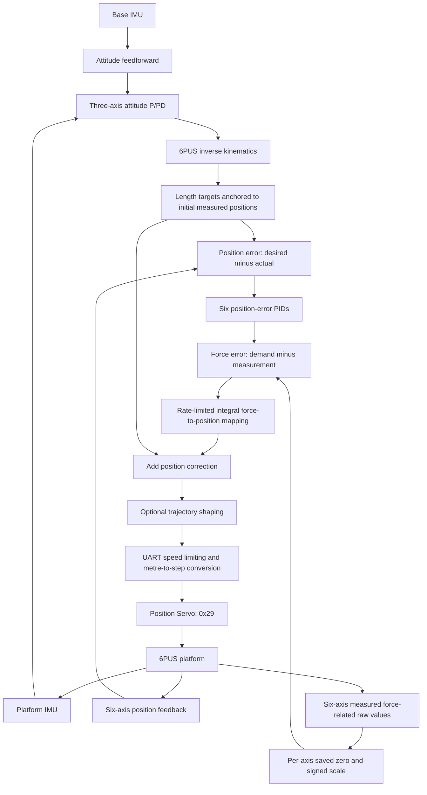

> 历史首页归档：保留整理前工作区内的完整内容（包括未提交的 Markdown 修改），不是当前原生 Mode 3 使用说明。当前入口见[项目 README](../../../README.md)。

# 6PUS Native Force Control

See [Force lifecycle repair and manual recovery](../../operations/force_shutdown_history.md) for the current stop policy and operator entry. The default recovery command is offline only; the new recovery paths still require hardware validation.

[English](../../../README.md) | [简体中文](../../../README_CN.md)

The development target is task-space Z force PID using the actuators' native Mode 3 force control (`0x27` target, `0x2C` feedback). Stage 1 provides an independently buildable ROS 2 package, physical-time first-order reference limiting, spatial wrench mapping and offline tests. It has no live hardware loop yet.

Start with [Stage 1 build, interfaces and limitations](../force_stages/force_control_stage1.md). The new package is `bone_ws/src/pus6_force_control`. Position reference speed (m/s) and force reference rate (N/s) are configured separately. No third-order jerk shaper is used by the force package.

Current status: [Stage 2.1 force feedback chain](../force_stages/force_control_stage2_1.md). Raw force fields now pass through the existing J14 scheduler, IPC and Bridge; position and force share Fixed-Lag alignment. Fault handling and dry-run topic isolation are verified in software. Mode 3 hardware closed-loop control remains pending.

The material below describes the retained historical force-assisted **position** control path (Route A), which sends `0x29` position targets in Servo Mode 1. It is available as reference code and is separate from the new force PID package.

## Control architecture

Route A retains the original Base-IMU attitude feedforward, Platform-IMU feedback, three-axis attitude P/PD structure and 6PUS inverse kinematics. It adds six position-error controllers and a force-feedback compensation loop before the position Servo.



The attitude layer uses the inherited quaternion reference handling, coordinate transform and SO(3) residual composition. The inverse of the relative base rotation supplies geometric feedforward; platform attitude error supplies the residual feedback. The runtime captures the first valid dual-IMU reference and anchors IK length changes to the first measured actuator positions. It does not command a startup move to model HOME. The stabilization reference is the initial attitude inferred from the IMUs, rather than an externally measured absolute orientation.

### Position error, force feedback and compensation

For each axis `i`, the implementation in [controller.py](../../../bone_ws/scripts/research/force_position_control/controller.py) evaluates:

```text
e_q[i,k]       = q_d[i,k] - q[i,k]                         [m]
I[i,k]         = I[i,k-1] + e_q[i,k] * dt[i]
D[i,k]         = (e_q[i,k] - e_q[i,k-1]) / dt[i]
F_cmd[i,k]     = clip(Kp[i]*e_q[i,k] + Ki[i]*I[i,k]
                     + Kd[i]*D[i,k], -F_limit[i], F_limit[i])
F_actual[i,k]  = relative_scale[i] * (raw_0x2C[i,k] - raw_zero[i])
e_F[i,k]       = F_cmd[i,k] - F_actual[i,k]
v_corr[i,k]    = clip(A[i]*e_F[i,k], -v_limit[i], v_limit[i])
delta_q[i,k]   = clip(delta_q[i,k-1] + v_corr[i,k]*dt[i],
                     q_min[i]-q_d[i,k], q_max[i]-q_d[i,k])
q_cmd[i,k]     = q_d[i,k] + delta_q[i,k]                     [m]
```

Here `q_d` is the anchored IK target, and `q` is measured length. `dt[i]` comes from successive per-axis host receipt timestamps. The PID conditionally holds its integral when force-demand saturation would be driven further; the derivative is a finite difference of position error. The first valid sample initializes state without issuing a controller position target. The current saved configuration has `Ki=Kd=0` for both attitude and position-error controllers; the implementations retain their configurable PID structures.

**`F_cmd`, `F_actual` and `e_F` currently use `relative_raw`, not N.** The `F` notation denotes an incremental force-related demand, measurement and error on a common relative scale. The position PID generates the demand from length error; it does not command torque or directly write a drive register. Measured force changes provide information about loading that position error alone does not contain. The saved stationary reference can include gravity and static load, so a zero relative reading does not mean zero physical force.

The dynamic mapping integrates force error into a position offset. Its state persists between samples; it is not a static force-to-displacement multiplication or an implemented mass–spring–damper model. With positive `relative_scale` and `A`, an increase in measured force at unchanged demand reduces the position correction. Actual physical feedback direction depends on each sensor's installation and configured sign. Force feedback changes `e_F` and `delta_q` directly; it changes the position PID output through the resulting position feedback, not through an extra PID input.

The corrected target passes through the optional trajectory shaper and then the sole UART owner's speed limiter and step conversion. In the current saved configuration, the extra trajectory filter is **disabled**; UART time-based speed limiting remains active. [ros_node.py](../../../bone_ws/scripts/research/force_position_control/ros_node.py) pairs position and force from the same status frames. These are six sequentially received frames, not simultaneous device samples. [uart_driver.py](../../../bone_ws/scripts/research/force_position_control/uart_driver.py) validates all six targets before issuing position writes, without automatic motion-write retries.

### Comparison with the original controller

| Stage | Baseline: dual-IMU feedforward + Classical P/PD | Proposed: Route A |
| --- | --- | --- |
| Attitude and IK | Base feedforward, platform attitude feedback, three-axis P/PD, IK | Retained upstream structure |
| Actuator feedback | Position Servo tracks length targets | Position error generates a relative force demand; measured force changes close the added compensation loop |
| Position target | Original length target | Original target plus dynamic force-based correction |
| Drive interface | Position Servo | Same position Servo, `0x29` |

The main reference is [J14 Feedforward + Classical P/PD](https://github.com/LiorenYuhang/6pus-bone-drill-position-control/blob/main/bone_ws/scripts/run_j14_demo_feedforward_pd.sh) in the independent [position-control repository](https://github.com/LiorenYuhang/6pus-bone-drill-position-control). Route A's independent runtime does not require a J14 process. Historical algorithms and experiments remain in the repository; they are not alternative names for this active control path or evidence of its performance improvement.

## Hardware, units and configuration

| Item | Current implementation or setting |
| --- | --- |
| Mechanism | Six-axis 6PUS parallel platform; three-axis attitude stabilization task |
| Sensors | Base and platform IMUs; six-axis position, raw force-related values and ADC feedback |
| Drive | One UART owner; position mode `0x25=1`; target positions via `0x29` |
| Position range | 0–2000 steps, intersected with actual read-back drive limits and existing geometry constraints |
| Conversion | 1 step = 0.025 mm = 0.000025 m; 40 steps/mm |
| HOME | Geometry configuration currently defines 1000 steps for each axis |
| Software velocity cap | 17 mm/s for all axes, based on the LAF50-024D manufacturer's nominal **unloaded** speed; not a measured loaded maximum or demonstrated platform speed |
| Control period | Nominal 20 ms; actual feedback intervals are checked |
| Force representation | Per-axis zero-referenced `relative_raw`; absolute force in N is not calibrated |
| Extra trajectory filter | Disabled in the saved configuration; UART velocity limiting retained |

The [geometry configuration](../../../bone_ws/src/pus6_kinematics/config/6pus_geometry.yaml) maps raw steps to the IK length coordinate as `q[i] = 0.05 + (steps[i]-1000)*0.000025` m. Thus 0–2000 steps correspond to 0–50 mm of displacement from raw zero and 0.025–0.075 m in that model coordinate. These are different references, not two different actuator travels.

Adding force feedback does not change the mechanism, geometry or available workspace. The current compensation has no arbitrary 50 μm cap: its admissible offset follows the final position bounds. Real mechanical, kinematic and driver protections remain applicable; the software command range does not establish that every six-axis combination is kinematically feasible.

The runtime loads [calibrated_config.json](../../../bone_ws/scripts/research/force_position_control/calibrated_config.json). It stores independent `raw_zero` and signed `relative_scale` values for six axes and does not automatically tare on startup. Position-PID gains `kp/ki/kd` have units relative/m, relative/(m·s) and relative·s/m. `force_limit_relative` limits the demand; `admittance_m_per_relative_s` is the mapping coefficient `A`, in m/(relative·s); `correction_rate_m_s` limits correction velocity. The configuration is the authority for numerical values. Saved signs and scales are not a claim of completed physical direction or absolute-force calibration. The implementation also accepts a separately calibrated N configuration, but that is not the current relative mode.

## Build and run on the NUC

The commands below target the current NUC checkout on Ubuntu with ROS 2 Jazzy. This README-only update does not publish outstanding local runtime changes or the locally available startup script; it is not a claim that a fresh GitHub checkout contains those uncommitted files. See the [hardware and configuration guide](../research/6PUS_FORCE_POSITION_HARDWARE.md) for further operational details.

Build the independent workspace when needed:

```bash
cd /home/lyapunov/6pus_bone_drill_torque_control/bone_ws
source /opt/ros/jazzy/setup.bash
colcon --log-base log/force_position build --base-paths src \
  --build-base build/force_position --install-base install/force_position
```

Start the real Route A chain:

```bash
cd /home/lyapunov/6pus_bone_drill_torque_control
bash bone_ws/scripts/run_force_position_feedback_pid.sh
```

The script loads Jazzy and this workspace's `install/force_position/local_setup.bash`, then runs the source runtime with `/usr/bin/python3` and the saved configuration. It starts both IMU inputs and the independent UART owner. It may select position Servo at the measured current position; it does not automatically return HOME or introduce a startup HOME motion. Do not run another process that owns the same motor UART. An optional `--duration 10` requests a normal stop after ten seconds.

### Monitoring and logs

In another terminal, load the same environment and inspect the required topics:

```bash
cd /home/lyapunov/6pus_bone_drill_torque_control
source /opt/ros/jazzy/setup.bash
source bone_ws/install/force_position/local_setup.bash
ros2 topic echo --full-length /force_position/attitude
# Run the following commands separately or in additional terminals:
ros2 topic echo /force_position/position_feedback
ros2 topic echo /force_position/relative_force
ros2 topic echo /force_position/raw_force_feedback
ros2 topic echo --full-length /research_force_position/diagnostics
ros2 topic echo --full-length /force_position/uart_state
```

Attitude diagnostics contain `base_relative_rpy_rad` and `platform_relative_rpy_rad` in Roll/Pitch/Yaw order, in radians relative to the captured reference. Controller diagnostics include `desired_m`, `actual_m`, `error_m`, `force_cmd_relative`, `force_actual_relative`, `force_error_relative`, `correction_m`, `position_command_m` and `shaped_command_m`. UART state supplies actual feedback and fault codes; `position_acknowledged` log entries contain the transmitted step targets and acknowledgements.

Logs are saved under `results/force_position/<timestamp>/`, printed as `LOG_DIR` at startup. Each run contains `config.json`, `telemetry.jsonl`, `h30_base.log` and `h30_platform.log`. Force values keep their `relative_raw` label; host receipt timestamps must not be interpreted as synchronized device sampling times.

### Normal shutdown and faults

Use Ctrl+C in the running terminal, allow the requested duration to finish, or publish:

```bash
ros2 topic pub --once -w 1 /force_position/stop std_msgs/msg/Empty '{}'
```

Normal shutdown stops the current control stream, reads actual six-axis positions and generates a coordinated quintic HOME trajectory using the existing position Servo. UART communication and feedback remain alive throughout. After the final HOME targets, two consecutive status queries must confirm all six axes within the existing ±5-step HOME tolerance. The runtime then sends one pause command (`0x1A=1`) per axis, checks the responses and only then closes communication and exits. The log sequence is `home_started → home_confirmed → pause_complete → uart_stopped`.

Communication failures, invalid/stale position feedback and drive faults skip or abort HOME and enter the existing fault-pause path. Missing pause acknowledgements are reported as failures, not successful stops. Shutdown HOME/Pause has been checked with Mock software tests; those results do not establish real-hardware return accuracy or stopping performance.

## Research evaluation

The objective is to determine whether measured force changes improve three-axis attitude stabilization over the original position-control baseline. Compare static holding, separate Roll/Pitch/Yaw disturbances, two-axis and three-axis combinations, and continuous base disturbances. Use recorded Base-IMU curves to assess comparable inputs; manual disturbances are not automatically identical.

Report platform attitude-error RMS, Peak and P95 per axis, recovery time with an explicit criterion, and disturbance transmission from base to platform. Use six-axis position errors, relative force, PID demands, force errors, corrections, final commands, measured positions and saturation/protection events to explain the response. The intended outputs are control diagrams and models, paired Base/Platform response curves, relative-force and correction curves, quantitative comparisons, and an account of the method's mechanism, useful conditions and performance limits. Improvement must be established by real comparative data, not assumed from an additional feedback loop.

## Implementation map

- [Dual-IMU attitude processing and IK](../../../bone_ws/scripts/research/force_torque_control/imu_chain.py).
- [Position-error PID and dynamic mapping](../../../bone_ws/scripts/research/force_position_control/controller.py).
- [ROS feedback pairing and corrected targets](../../../bone_ws/scripts/research/force_position_control/ros_node.py).
- [Independent runtime and UART ownership](../../../bone_ws/scripts/research/force_position_control/runtime.py).
- [Position transport and normal HOME/Pause](../../../bone_ws/scripts/research/force_position_control/uart_driver.py).
- [Hardware operation and calibration guide](../research/6PUS_FORCE_POSITION_HARDWARE.md).

The original position-control repository remains independent. This documentation does not modify its algorithms or the research runtime. No repository-wide license has been established; component-level notices still apply.
