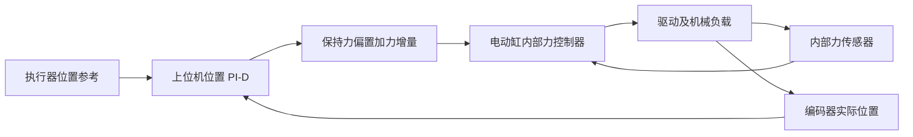
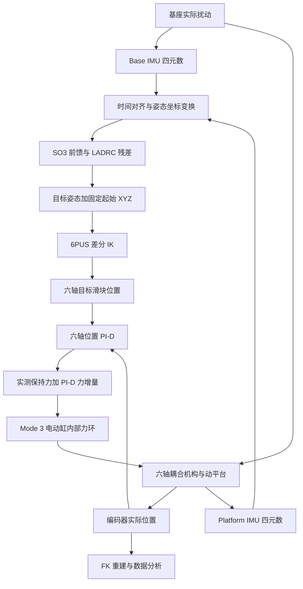
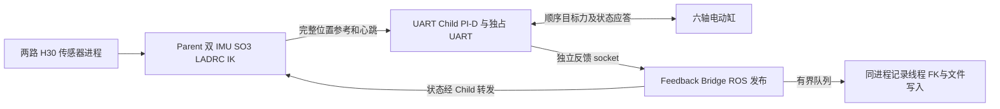
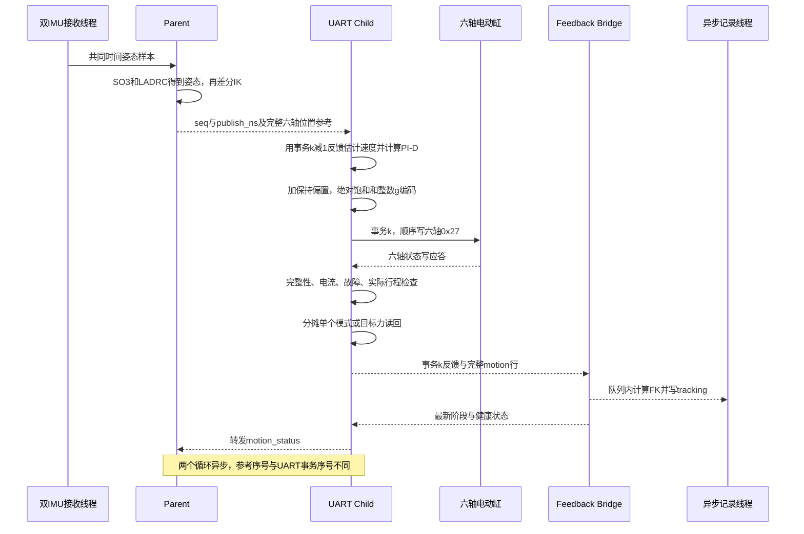

# 6PUS Force 原生力控系统：从控制原理到代码执行

本文面向需要系统学习代码、介绍控制方案和讨论实验结果的机器人与控制研究人员。它以 **2026-11-07 当前 Force 工作区实际执行代码**为依据，沿长期入口追踪双 IMU、姿态控制、IK、位置 PI-D、原生力指令、UART 反馈及退出返回 Home。源码中的后续本地修改也属于本次阅读对象；不把某个历史版本的参数当成当前所有入口的统一配置。

工程根目录为 `/home/lyapunov/6pus_bone_drill_force_control`。文中的源码链接相对此目录组织；文件表给出仓库内真实路径，函数名用于继续定位。本文只讲当前主链及其必要依赖，早期任务空间力分配、Route A 和离线力矩原型只用于说明边界。

**先记住这一句话：上位机根据位置误差决定六个电动缸应增加或减少多少轴向力，电动缸内部控制器负责跟踪这个目标力；六个执行器共同运动，使平台接近 IK 所要求的位姿。**

## 阅读导航

1. [项目研究目标与工程区别](#1-项目研究目标与工程区别)
2. [原生力控与串级闭环](#2-原生力控与串级闭环)
3. [整体系统与物理数据流](#3-整体系统与物理数据流)
4. [双 IMU、SO3 与 LADRC](#4-双-imuso3-与-ladrc)
5. [6PUS 运动学与六轴位置参考](#5-6pus-运动学与六轴位置参考)
6. [六轴位置 PI-D 的完整实现](#6-六轴位置-pi-d-的完整实现)
7. [Mode 3、协议与硬件反馈](#7-mode-3协议与硬件反馈)
8. [三进程与一次控制周期](#8-三进程与一次控制周期)
9. [从长期启动脚本顺着代码运行](#9-从长期启动脚本顺着代码运行)
10. [停止、Mode 0 恢复与自动 Home](#10-停止mode-0-恢复与自动-home)
11. [核心文件索引与源码阅读顺序](#11-核心文件索引与源码阅读顺序)
12. [验证证据、实现差异与研究局限](#12-验证证据实现差异与研究局限)

## 1. 项目研究目标与工程区别

### 1.1 为什么从位置执行层继续研究原生力控

6PUS 平台已有位置伺服、运动学和双 IMU 姿态控制基础。位置执行方式把“电动缸应到哪里”交给设备内部位置控制器，容易与上层几何规划对接；但研究载荷变化、支撑力和主动稳定时，还希望能够显式决定执行器的轴向力需求。因此，本工程保留经过使用的姿态与 IK 思路，将执行层换成厂家原生力模式，并在上位机闭合位置环。

这里研究的是**通过力来实现运动与姿态保持**。它不是让平台沿 Z 跟踪外部接触力，也不是直接执行任务空间六维力/力矩指令。对基座扰动的期望效果是：Base 的姿态变化产生几何反向补偿，Platform 的实际姿态反馈修正剩余误差，六个电动缸以原生力模式跟踪相应位置参考。当前先保持本次起始平移参考，同时控制 Roll、Pitch、Yaw。

### 1.2 Position、Torque 与 Force 各自控制什么

| 工程/路径 | 上位机最终发送什么 | 控制意义 |
|---|---|---|
| Position 的位置 Servo | 电动缸位置目标 | 姿态控制和 IK 决定位置，电机内部位置伺服执行 |
| Torque 当前主要 Route A | 受力补偿后的位置目标 | 根据实际受力变化修正位置指令，执行器仍为位置伺服 |
| 本文 Force 三进程入口 | 电动缸轴向力目标，Mode 3 | 上位机位置 PI-D 决定力增量，设备内部力闭环执行 |
| Force 正常退出后的 Home | 独立位置 Servo 轨迹 | 主动力控结束后的位置返回，不属于 Mode 3 主动稳定 |

`torque_control` 是工程名称，不能直接推出真实执行器接收 N·m 指令。直线电动缸的轴向力单位是 N；电机轴力矩单位是 N·m，二者涉及传动机构、效率和内部控制，当前主链没有建立把轴向力目标等同为电机轴力矩的映射。不要把其他研究目录中的力矩变量套到本入口。

### 1.3 本工程选择的控制思路

系统采用“**姿态控制 → 运动学位置参考 → 位置 PI-D → 内部力闭环**”。这允许继续使用机构的几何模型，且无需先辨识完整质量、惯性、摩擦和传动动力学。但没有完整动力学模型并不意味着动力学不存在：惯性、摩擦、预载、电动缸内部力环和六轴机械耦合共同影响实际响应，必须通过真机数据研究。

## 2. 原生力控与串级闭环

### 2.1 电动缸内部负责力闭环

本机构采用带内部力传感器的力闭环电动缸。厂家接口将目标力和实际力表示为有符号 **g**。Mode 3 下，内部控制器比较所接收的目标力与内部传感器反馈，并调节驱动输出。上位机能看到目标寄存器读回、实际力、位置、电流等状态，但没有源码或实验证据可以给出其内部力环的具体增益、带宽和采样率。

因此应区分三个事实：目标寄存器读回正确，说明设备保存了该目标；实际力反馈变化，说明传感器观测发生变化；实际位置/姿态跟踪良好，才说明机构实现了期望运动。前三者不能相互替代。

### 2.2 力指令为什么会导致位置变化

电动缸对机构施加轴向力，改变支链受力和平衡状态。在几何约束、重力、载荷及摩擦共同作用下，平台产生或抑制运动。若只给一个固定力，不能保证平台保持指定位置；当前方案持续读取编码器，依据位置误差修正力，形成外层位置闭环。

例如某轴参考位置高于实际位置时，P 项按当前约定产生正向力增量；若执行器已快速朝目标运动，D 项产生与速度相反的阻尼；如果长期停在目标附近但存在持续偏差，I 项逐步学习所需附加支撑力。这些是反馈控制的作用机理，不是已识别的精确力—位移模型。

### 2.3 两层反馈分别在哪里闭合



位置 PI-D 的输入不是 `目标力−实际力`。它计算的是达到位置参考需要的轴向力增量。实际力反馈主要用于本次保持力交接、数据记录及状态检查；设备内部力控制器负责力误差闭环。本入口没有在上位机再串入另一个直接力误差 PID。

名义转换采用 `1 g = 0.00980665 N`。这是[force_units.py](../../bone_ws/src/pus6_motor_driver/pus6_motor_driver/force_units.py)的单位换算，不是实物六轴绝对力标定，也不能由软件清零推断实际预载已经消失。

## 3. 整体系统与物理数据流

### 3.1 机构、传感器与控制层

六条 6PUS 支链连接基座与动平台。每条支链的直线滑块由电动缸驱动，滑块经固定长度连杆和关节约束平台运动。Base IMU 安装在基座，Platform IMU 安装在动平台。上位机处理两路姿态，计算所需平台姿态，再由运动学确定六个滑块位置。



实际平台位姿不能由六个位置环分别评价。即便只要求某一个姿态自由度变化，IK 通常也会要求多个电动缸协同运动。六个 PI-D 是执行层分配方式，不代表机构在动力学上解耦。

### 3.2 先统一变量与坐标

| 符号 | 含义 | 单位/约定 |
|---|---|---|
| `p=[x,y,z]` | 平台原点在基座模型系中的平移 | m |
| `R` | 平台相对基座的旋转矩阵 | SO(3)，无量纲 |
| `pose=[x,y,z,roll,pitch,yaw]` | IK/FK 位姿接口 | m、rad；`R=Rz(yaw)Ry(pitch)Rx(roll)` |
| `q_i` | 第 i 轴模型滑块坐标，不是四元数 | m |
| `s_i` | 第 i 轴原始编码器位置 | steps |
| `qB,qP` | Base/Platform 四元数 | `[x,y,z,w]`，与滑块变量靠上下文区分 |
| `ΔF_i` | 位置 PI-D 力增量 | N |
| `F_hold,i` / `F_cmd,i` | 保持力偏置 / 最终目标力 | 上位机 N；设备接口 g |
| `t_rx,i` | 主机收到第 i 轴反馈的时间 | 单调 ns，换算为 s 后参与估计 |

IK 固定的是基座模型系中的起始 XYZ，不是利用外部定位器保持世界系 XYZ。双 IMU 提供姿态信息，本链没有平台绝对平移测量。FK 是几何模型加编码器反馈的重建，不是独立外部精度测量。

## 4. 双 IMU、SO3 与 LADRC

### 4.1 实际数据从哪里进入

两路 ROS 话题为 `/pus6/imu_base/data` 和 `/pus6/imu_platform/data`，消息类型 `sensor_msgs/Imu`，使用 sensor-data QoS。[RosDualImuSource](../../bone_ws/src/pus6_force_control/pus6_force_control/mode3_dual_imu.py) 在独立 ROS context 中创建订阅，由 `SingleThreadedExecutor` 工作线程执行 `receive()`。

指定 `--start-imus` 时，`start_sensors()` 先检查发布者数量。已有唯一发布者就复用；没有时检查设备端口占用，再启动当前环境中的 `h30_imu_node`。电机 UART 默认 921600 baud，两路 H30 为 460800 baud，属于不同串口。传感器启动日志分别写入 `base_imu.log`、`platform_imu.log`。`RosDualImuSource.__init__()` 最多等待 10 s 获取有效姿态历史，失败时还未启动电机 owner。

H30 的[驱动 `publish()`](../../bone_ws/src/h30_imu/src/h30_imu_node.cpp)可发布只有角速度/加速度的消息；没有有效姿态时将 `orientation_covariance[0]` 置为 −1。Force 的 `receive()` 必须跳过这种消息，否则连续到来的陀螺仪消息会让陈旧姿态看起来“仍然新鲜”。接收回调记录 `time.monotonic_ns()` 和 ROS header 时间，但后者只作诊断。

### 4.2 四元数检查与时间对齐

[DualQuaternionBuffer.push()](../../bone_ws/src/pus6_force_control/pus6_force_control/dual_imu_attitude.py)通过 `valid_quaternion()` 检查四个有限分量、拒绝接近零模长，并归一化。每路最多保留 200 个样本，接收时间必须严格增加，历史访问使用线程锁。

`snapshot(now_ns)` 对两路各要求至少两个样本，取共同时间：

$$
t_* = \min(t_{B,\mathrm{latest}},t_{P,\mathrm{latest}}).
$$

`t_*` 是两路最新接收时间中较早的时刻。每一路都寻找夹住该时刻的样本 `t_L≤t_*≤t_R`，按

$$
\alpha=\frac{t_*-t_L}{t_R-t_L},\qquad
q(t_*)=\operatorname{SLERP}(q_L,q_R,\alpha)
$$

进行球面插值。这里时间差可同用 ns，比例无量纲；姿态没有外推。最新姿态龄期、共同时间龄期和插值跨度均受既有 100 ms 检查。返回诊断记录插值区间、比例及 header 时间。

这是**主机接收时间对齐**，并非硬件同步，也不能消除 USB、串口和传感器内部延迟。两路参考之间的时间差被显式处理，不应说成“两个传感器同一时刻采样”。

### 4.3 捕获参考与机械坐标转换

[PositionLadrcAttitude.capture()](../../bone_ws/src/pus6_force_control/pus6_force_control/dual_imu_attitude.py)保存本次编码器 FK 得到的初始姿态 `R0`，以及两路初始四元数 `qB0,qP0`，并将 LADRC 和 Classical 对照控制器复位。后续相对四元数由 [relative_quat()](../../bone_ws/src/pus6_force_control/pus6_force_control/position_attitude_math.py)计算：

$$
q_{B,rel}=q_{B0}^{-1}\otimes q_B,\qquad
q_{P,rel}=q_{P0}^{-1}\otimes q_P.
$$

机械安装变换沿用 `apply_z90_transform()`，相当于 `C=Rz(+90°)` 的共轭变换：

$$
R_B=C R(q_{B,rel})C^T,\qquad
R_{P,rel}=C R(q_{P,rel})C^T,\qquad
R_P=R_0R_{P,rel}.
$$

`R_B` 表示基座相对捕获姿态的机械系变化；`R_P` 表示按初始参考重建的平台姿态。此处“世界参考”是初始化建立的局部参考，不是外部测量得到的绝对真值。坐标变换复用现有机械约定，不读取 YAML 中尚为 null 的完整 IMU 外参矩阵。

### 4.4 SO(3) 姿态误差与前馈

`compute_so3_platform_error()` 计算

$$
E_W=R_0R_P^T,\qquad e_W=\operatorname{Log}(E_W)^\vee.
$$

`e_W` 为三维旋转向量，单位 rad，方向是把实际平台姿态转回参考姿态。例如在局部小角度条件下，平台正 Roll 偏差会形成负 Roll 修正误差。这里不直接相减两个 Euler 角。

Base 前馈为 `R_ff=R_BᵀR0`。如果平台能精确实现它，则在这套相对参考关系中有 `R_B R_ff=R0`，因此基座正旋转得到反向的几何补偿。Platform IMU 则用于观测实际剩余偏差，不能用“前馈目标已经反向”推断平台实际已经稳定。

### 4.5 LADRC 的实际离散计算

[position_ladrc.py](../../bone_ws/src/pus6_force_control/pus6_force_control/position_ladrc.py)的 `ThreeAxisLadrc` 包含三个 `FirstOrderLadrcChannel`。每个通道采用名义误差模型

$$
\dot e=f-b_0u,
$$

其中 `e` 为对应世界姿态误差分量（rad），`u` 为角度残差指令（rad），`b0` 为名义输入增益（s⁻¹），`f` 为等效集总扰动（rad/s）。它不是电动缸力模型，也不是完整机构动力学。

二阶 LESO 的状态 `z1≈e`（rad）、`z2≈f`（rad/s），连续形式为

$$
\dot z_1=z_2-b_0u_{prev}+2\omega_o(e-z_1),\qquad
\dot z_2=\omega_o^2(e-z_1).
$$

`compute_discrete_matrices(dt)` 使用精确 ZOH 离散化，不是简单 Euler 积分。令 `T=dt`（s）、`w=ωoT`、`E=exp(−w)`，代码采用

$$
\Phi=E\begin{bmatrix}1-w&T\\-\omega_o^2T&1+w\end{bmatrix},\quad
\Gamma_u=\begin{bmatrix}-b_0TE\\b_0[1-E(1+w)]\end{bmatrix},\quad
\Gamma_y=\begin{bmatrix}1-E(1-w)\\E\omega_o^2T\end{bmatrix}.
$$

`observer_update()` 按 `z_k=Φz_(k−1)+Γu·u_prev+Γy·e_k` 更新，然后 `compute_shadow_command()` 计算

$$
u_{raw}=\frac{\omega_cz_1+z_2}{b_0},\qquad
u=\operatorname{clip}(u_{raw},-u_{max},u_{max}).
$$

虽然函数名沿用 `shadow`，当前 `PositionLadrcAttitude.update()` **实际使用这个限幅后的 LADRC 残差生成姿态目标**，不是只记录不执行。Classical P/PD 同时计算为对照，不与 LADRC 再相加。

| 通道 | b0 / s⁻¹ | ωc / s⁻¹（配置按 rad/s 表述带宽） | ωo / s⁻¹ | 残差边界 |
|---|---:|---:|---:|---:|
| Roll | 20 | 0.8 | 2.5 | ±0.5° |
| Pitch | 10 | 1.0 | 4.0 | ±0.5° |
| Yaw | 6 | 0.25 | 1.2 | ±0.5° |

这些值来自 [mode3_dual_imu.yaml](../../bone_ws/src/pus6_force_control/config/mode3_dual_imu.yaml)。±0.5° 是原 LADRC **附加残差**的边界，不是基座扰动或 Base 逆向前馈的 ±0.5° 限制。姿态样本间隔小于 1 ms 时保持原目标且不推进观测器；大于 100 ms 时该适配层报错，不能认为内部名义 dt 回退会让陈旧 IMU 继续运行。

实际传给 LESO 的 `u_prev` 是上一次算法送入姿态/IK 链的角度残差。字段虽叫 `prior_dispatched_residual_rad`，它不是电机接受/实现反馈，不是实际力，也不是通过平台响应辨识得到的真实输入。模型近似与执行滞后之间仍有差距。

### 4.6 最终姿态如何合成

`compose_so3_pid_residual()` 先形成世界系残差旋转，再变换到基座系：

$$
\Delta R_W=\operatorname{Exp}([u]_\times),\quad
\Delta R_B=R_B^T\Delta R_WR_B,\quad
R_{cmd}=\Delta R_BR_{ff}=R_B^T\Delta R_WR_0.
$$

`u` 是三轴角度残差（rad）；`Exp` 将旋转向量映射为旋转矩阵。矩阵次序不能任意交换，特别是初始 `R0` 不为单位阵时。源码注释中“等价于 `R_ff @ ΔR_W`”不能不加条件地套用到一般 `R0`；当前真实执行表达式和非交换旋转测试支持的是上式。

最后以 SciPy `as_euler('xyz')` 生成目标 Roll/Pitch/Yaw，与固定初始 XYZ 拼为位姿。长期入口默认三轴全开；代码也保留选择轴的 mask，这不是当前三轴目标的隐式缩放。

## 5. 6PUS 运动学与六轴位置参考

### 5.1 不是通用伸缩支腿 Stewart 的长度公式

[Analytical6PusKinematics.inverse_kinematics()](../../bone_ws/src/pus6_kinematics/pus6_kinematics/analytical_6pus.py)求的是**沿基座 Z 方向运动的滑块坐标**，连杆长度固定。设第 i 个基座滑轨横向坐标为 `a_i=(a_ix,a_iy,0)`，平台局部连接点为 `b_i`，连杆长度为 `L`：

$$
B_i=p+Rb_i,\quad d_{ix}=B_{ix}-a_{ix},\quad d_{iy}=B_{iy}-a_{iy},
$$

$$
q_i=B_{iz}-\sqrt{L^2-d_{ix}^2-d_{iy}^2}.
$$

`p,B,a,b,q,L` 均为 m，`R` 无量纲。滑块点是 `(a_ix,a_iy,q_i)`，它与 `B_i` 的距离为固定 `L`。源码取上述减号分支，保持当前装配构型，而不是在两个数学分支间自动切换。

模型参数来自 [6pus_geometry.yaml](../../bone_ws/src/pus6_kinematics/config/6pus_geometry.yaml)：基座半径 40 mm、平台半径 27.5 mm、连杆 84 mm、名义 Home 高度约 132.612268 mm；六个锚点按电机 ID 1–6 排列。加载器默认优先考虑显式路径或 `PUS6_GEOMETRY_CONFIG`，再考虑源码和安装目录，不能仅因某份 YAML 存在就断言运行一定加载它。

### 5.2 从真实位置建立差分参考

Parent 在 `DualImuPlan.__init__()` 中把实际编码器 `s_initial` 转为模型 `q_initial`，再调用 FK 得到 `pose_initial`。它保存 `IK(pose_initial)`，每轮目标为

$$
q_{ref}=q_{initial}+IK(pose_{target})-IK(pose_{initial}).
$$

因此初始目标等于实际 `q_initial`，即使数值 FK 与 IK 往返存在微小残差，也不会要求六轴突然跳到纯模型解。起始位置不是写死的 `[1000]*6`；CLI 的 `--initial-steps` 只用于 Mock 初始化。

### 5.3 米和 steps 的真正映射

[raw_steps_to_slider_m()](../../bone_ws/src/pus6_force_control/pus6_force_control/force_pipeline.py)和 [slider_to_steps()](../../bone_ws/src/pus6_force_control/pus6_force_control/z_position_motion.py)互为当前坐标映射：

$$
q_i=q_{home,i}+(s_i-s_{home,i})c_s,\qquad
s_{ref,i}=s_{home,i}+\frac{q_{ref,i}-q_{home,i}}{c_s}.
$$

其中 `q_home=0.05 m`、`s_home=1000 steps`、`c_s=0.000025 m/step`。所以原始 1000 steps 在**模型滑块系**中是 0.05 m，不是直接乘步距得到的 0.025 m。物理原始位移和模型坐标有不同零点。正常 Mode 3 PI-D 使用浮点米参考，并不把这些 steps 直接写为位置运动指令。

### 5.4 可达性与实际位置保护分开

`inverse_kinematics()` 检查平台高度 0.05–0.30 m、根号项是否可实现；根号轻微负值在原 `1e−9 m²` 数值容差内置零，明显负值抛出 `WorkspaceLimitError`。**它本身没有实际执行滑块 min/max 行程逐项判断**，尽管函数说明概括了 out-of-stroke；在线行程判断由 `DualImuPlan.constrain_pose()` 和 Child 完成。

在线六轴边界取几何正常范围、绝对原始范围、软件上限和设备 `0x24/0x23` 读回的交集，通常为 200–1800 steps，对应模型 0.03–0.07 m。`constrain_pose()` 保持初始 XYZ，计算完整差分 IK 后检查每轴目标；超出时产生 `IK_TARGET_WORKSPACE_BOUND`，几何无解时产生 `IK_TARGET_KINEMATIC_UNREACHABLE`。二者都拒绝本次目标，不通过旋转缩放悄悄替换目标。

实际编码器越界由 Child `_check_positions()` 报 `ACTUAL_POSITION_MECHANICAL_BOUND`，不是目标不可达。目标余量和实际余量均按下/上边界分别记录。保留的 `envelope_margin_steps=100` 是继承设置字段，当前双 IMU 目标并不使用起点 ±100 steps 小框，两个额外 margin 常量均为零。

### 5.5 FK 在哪里计算、代表什么

`forward_kinematics_with_metrics()` 解六条连杆长度约束：`f_i=||p+Rb_i−(a_ix,a_iy,q_i)||−L=0`。它使用解析导数和阻尼 Gauss–Newton / LM 形式更新六维位姿，返回收敛标志、残差及迭代次数。初始建立参考时 Parent 调一次；正常运行中由 Bridge 的异步记录线程计算，并用上次成功解作初值。UART Child 不执行 FK。

该函数参数默认最多 30 次迭代、残差范数容差 `1e−10 m`。这是数值求解容差，不是机器人绝对定位精度。源码虽有“Armijo line search”注释，当前实际只应用 `x_k+dx` 一次更新，没有实现回溯搜索；阅读时应以循环体为准。

## 6. 六轴位置 PI-D 的完整实现

### 6.1 先看输入、输出和执行位置

真正计算力增量的是 [JointPositionForcePID.update()](../../bone_ws/src/pus6_force_control/pus6_force_control/joint_position_force_pid.py)，由 [JointPositionServoCore.cycle()](../../bone_ws/src/pus6_force_control/pus6_force_control/mode3_process_child.py)在 UART Child 中调用。它不在 ROS 回调中计算，不依赖 FK 姿态误差，也没有以实际力误差替代位置输入。

$$
e_i=q_{i,\mathrm{ref}}-q_{i,\mathrm{actual}}.
$$

`q_ref` 是 Parent 发来的最新完整 IK 滑块位置，`q_actual` 是 Child 已读取的最新编码器位置，经模型映射后单位均为 m。输出 `ΔF_i` 为 N；最终设备目标还要叠加保持偏置、处理绝对饱和并转换成 g。把这三层混在一起，会误把“PI-D 要求 −12 N”和“最终发出 −12 N”视为同一个值。

### 6.2 当前参数是经过覆盖得到的

不要直接抄 `JointForcePIDConfig` 的 dataclass 默认值。实际配置生成顺序是：

```text
z_position_motion.pid_config(plan)
  → 取得原运动 PI-D 的基础配置和当前实际边界
DualImuPlan.pid_overrides
  → 覆盖 D 增益、连续速度、真实误差积分等双 IMU 行为
mode3_process_policy.PID_OVERRIDES
  → 仅三进程取消积分/增量实验限幅及跟踪误差硬退出
Parent 将有效配置放入完整参考
  → Child 首次 _enter() 构造 JointForcePIDConfig 和 PI-D 实例
```

| 当前三进程有效参数 | 值 | 含义 |
|---|---|---|
| `joint_kp_n_m` | 六轴均 8000 N/m | 位置误差到比例力 |
| `joint_ki_n_m_s` | 六轴均 6000 N/(m·s) | 真实误差到积分贡献增长率 |
| `joint_kd_n_s_m` | 六轴均 1000 N·s/m | 测量速度阻尼 |
| `joint_position_deadband_m` | 25 μm，1 step | P 和真实积分分别对各自误差应用死区 |
| `joint_velocity_window_s` | 0.08 s | 连续速度回归窗口 |
| `joint_derivative_filter_tau_s` | 0.04 s | 速度/D 一阶滤波时间常数 |
| `joint_prediction_horizon_s` | 0.02 s | 在反馈年龄之外增加的 P 预测时域 |
| `joint_use_latest_feedback` | true | 使用各轴原接收时间与最新位置 |
| `joint_continuous_velocity` | true | 不因位置跨度小于旧噪声门限强制速度为零 |
| `joint_active_braking` | true | P 使用预测位置；不表示正常力斜率恢复生效 |
| `joint_integrate_while_moving` | true | 运动时允许按真实误差积分/回退 |
| `joint_integral_from_measured_error` | true | 积分判断不使用预测误差 |
| `joint_max_reference_speed_m_s` | None | 直接采用最新 IK，未创建位置参考限速器 |
| `joint_integral_limit_n` / `joint_increment_limit_n` | None / None | 不施加旧 ±2.5 N 积分和 ±4 N 增量上限 |
| `joint_max_tracking_error_m` | None | 记录跟踪误差；无旧 2.5 mm 跟踪硬退出 |
| `force_slew_compensation` | false，构造参数 | 不追加旧力斜率延迟预测时域 |

这些值只适用于本文长期三进程入口。Z 轨迹、原单进程双 IMU 等仍使用各自配置；部分对应测试刻意验证旧配置没有改变。因此看到某个测试仍断言 ±4 N 或 2.5 mm，不说明当前三进程又启用了它。

### 6.3 一个周期到底用哪一组位置

Child 先取本地 `positions`、`rx_ns`，将它们传入 `pid.update()`；得到力后才发出当前六轴事务、接收新的反馈。这意味着正常周期 k 的 PI-D 输入通常来自事务 k−1，首次来自初始化/Mode 3 交接的反馈。

`sample_ns=max(position_stamps_ns)`，计算 `dt=(sample_ns−previous_sample_ns)×1e−9 s`，必须为正；并非固定用 0.02 s 积分。各轴反馈年龄另算 `age_i=(now_ns−t_rx,i)×1e−9 s`，要求在 0–200 ms 内。六轴最新时间取最大值并不让它们变成同步采样。

在 tracking 中，`pid.joint_measured_m`、`pid_input_rx_ns` 对应上述输入；顶层 `actual_positions_steps`、`feedback_rx_ns` 则是本次写力后取得的新反馈。顶层误差与 `pid.joint_error_m` 因此可能不同，这不是必然的记录错误。

### 6.4 速度回归与连续滤波

每轴保留位置及原时间戳历史。对窗口内样本 `(t_j,q_j)`，把时间换算为 s，再按最小二乘斜率估计速度：

$$
v_{raw,i}=\frac{\sum_j(t_j-\bar t)(q_j-\bar q)}{\sum_j(t_j-\bar t)^2}\quad[\mathrm{m/s}].
$$

代码至少需要三个样本、且分母非零才估计斜率；初始化早期不足时为零。窗口目标为 80 ms，裁剪时至少保留两个样本。当前 `joint_continuous_velocity=True` 绕过旧 `joint_velocity_noise_span_m=37.5 μm` 的跨度门限，所以一个编码器 step 的渐进运动不会仅因“不到 1.5 steps”而让速度突然归零。

滤波使用各轴新样本间隔 `Δt_i`，不是 Parent 参考更新时间：

$$
\alpha_i=1-e^{-\Delta t_i/\tau_D},\qquad
\hat v_i\leftarrow\hat v_i+\alpha_i(v_{raw,i}-\hat v_i),\qquad \tau_D=0.04\ \mathrm{s}.
$$

某轴重复接收同一源时间时 `α_i=0`，不再次推进该轴滤波；同一时间位置却改变会报错。全部轴的整体样本时间不前进则在 dt 检查失败。静止后原斜率逐渐衰减、滤波速度连续趋零；滤波减少突变，但也引入阻尼相位延迟，不能视为没有动态代价。

### 6.5 P：预测位置误差对应比例力

先定义原代码使用的死区函数：

$$
\mathcal D_\epsilon(e)=\begin{cases}0,&|e|\le\epsilon\\e,&|e|>\epsilon\end{cases},\qquad \epsilon=25\ \mu\mathrm m.
$$

这是“区内置零、区外保留原误差”，不是区外再减去一个死区宽度。实际判断还包含很小的浮点容差。

预测位置、P 项为

$$
h_i=age_i+0.02\ \mathrm s,\quad
\hat q_i=q_i+\hat v_i h_i,\quad
P_i=K_{p,i}\mathcal D_\epsilon(q_{ref,i}-\hat q_i).
$$

`h_i` 单位 s，`q_hat` 单位 m，P 单位 N。执行器已经朝目标运动时，预测位置更接近目标，比例力可以提前减小。`joint_brake_horizon_cap_s` 等继承字段虽然仍存在，但当前 `force_slew_compensation=False`，不使用“移除上一力指令需要多久”的附加预测。

### 6.6 I：真实编码器误差累积支撑修正

当前积分保存的状态已经是力贡献 N，而不是单独的 `∫e dt`：

$$
e_{I,i}=\mathcal D_\epsilon(q_{ref,i}-q_i),\qquad
I_{candidate,i}=I_{old,i}+K_{i,i}e_{I,i}\,dt.
$$

其中 `Ki` 为 N/(m·s)，故每次增量为 N。当前独立积分幅值上限为 None；运动中也允许积分，而非速度非零就冻结。这样既能学习持续负载修正，也能在误差反向时逐步消除旧积分。

如果编码器误差在 ±1 step 内，但速度预测使 P 误差跑出死区，仍然不能因此积分。这正是 `joint_integral_from_measured_error=True` 的意义：P 的预测负责动态提前作用，I 负责真实持久位置偏差，二者不混用。

同一个实例跨 `initial_hold` 和 `stabilize`。进入主动阶段不清空 I、不重置速度；而 LADRC 在初始保持只更新时间基准、不推进观测器，避免第一次主动计算出现累积 1 秒 dt。

### 6.7 D：测量速度阻尼，不对位置参考求导

$$
D_i=-K_{d,i}\hat v_i\quad[\mathrm N].
$$

真实正向速度得到负阻尼力。参考位置突变而执行器还没运动时，不会因参考的阶跃导数生成 D kick。P 与 D 在接近目标时相互抵消通常是制动作用，不能一看到 `P×D<0` 就断言控制错误；但估计/滤波延迟、过大的阻尼和真实回撤不足也可能使响应滞后，需要结合反馈判断。

代码保存 `joint_pd_opposing_axes`、`joint_pd_cancellation_n` 等诊断。可先比较真实位置误差与预测误差，再看 P/I/D，最后检查实际发送的力，避免只分析未限幅请求。

### 6.8 力增量、保持偏置与绝对输出边界

PI-D 原始请求是

$$
\Delta F_{req,i}=P_i+I_i+D_i,\quad
F_{req,i}=0.00980665\,F_{hold,g,i}+\Delta F_{req,i},
$$

$$
F_{limited,i}=\operatorname{clip}(F_{req,i},-50,50)\ \mathrm N.
$$

这里 `F_hold,g` 是进入 Mode 3 前实际读到的有符号 g 偏置，运行期间保持捕获值，不每轮用新的实际力代替它。实时实际力仍记录，但不会在这个加法中反复引入新的保持偏置。保持力超出允许绝对目标范围时进入阶段拒绝，不将支撑力静默裁剪成另一个值。

[SixAxisForceDrive.command_forces_n()](../../bone_ws/src/pus6_force_control/pus6_force_control/six_axis_force_drive.py)按以下顺序处理：N 有限性检查 → 含偏置总力的 N 钳位 → `n_to_g()` → 当前正常运行直接绕过 g/s 整形 → 整数编码约束 → 构造每轴 `0x27` 帧。

`quantize_force_g_with_n_limits()` 先按 Python 最近整数、ties-to-even 舍入，再把上下边界向允许的整数域内收：

$$
g_i\in[\lceil-50/0.00980665\rceil,\lfloor50/0.00980665\rfloor]
=[-5098,5098].
$$

5098 g 对应约 49.9943 N；若直接把 50 N 四舍五入成 5099 g，会越过该软件规格边界。编码再检查有符号 int16，按补码转成 uint16 放入协议。不允许溢出回绕为相反符号。

`JointPositionServoCore.cycle()` 中的 `drive` 使用 `bus=None`、`dry_run=True` 只做上述计算和构帧；随后 `writer.send_force_cycle()` 才真正写 UART。因此在这里看到 `dry_run=True` **并不表示整个真机控制周期没有写电机**。

### 6.9 最终饱和后的抗积分饱和

六轴事务写入后，Child 将真正编码的目标力反算成力增量：

$$
\Delta F_{applied,i}=0.00980665\,(g_i-F_{hold,g,i}),\quad
d_i=\Delta F_{req,i}-\Delta F_{applied,i}.
$$

`track_applied()` 在 `d_i·e_I,i>0` 且 `|d_i|>0.005 N` 时，把本轮积分退回 `I_old`。差值门槛容忍约半个 g 的正常量化误差。这里的 applied 指**实际采用的编码命令**，不是传感器证实的物理输出力。

去掉 ±4 N 和 ±2.5 N 后，内部独立裁剪通常不再生效，但最终 ±50 N 和条件回退仍生效。当前周期发出的命令包含本轮候选积分；回退改变的是后续保存状态，不会撤销已经发送的 UART 指令。tracking 的 `joint_i_n` 是 update 返回时的值，最终回退是否发生要同时看 `final_integral_blocked_axes`。

一个说明性的静止例子：误差 1 mm、初始 I=0、dt=20 ms，则 P=8 N、单周期积分增量 0.12 N、D=0；还要加该轴实测保持偏置才是目标力。这只是按参数代入，不是一次真机测量。历史单帧记录中请求增量 −12.4287 N、偏置 −222 g，只取消旧增量截断后可编码为 −1489 g；不能将其解释为实际机构必然产生了同样的受力和运动。

## 7. Mode 3、协议与硬件反馈

### 7.1 使用的是当前厂家 UART 二进制协议

[protocol.py](../../bone_ws/src/pus6_motor_driver/pus6_motor_driver/protocol.py)定义 INSIM LAF D 型 UART 帧，不应因为总线为 RS485 就称它为 Modbus RTU。命令头 `55 AA`，响应头 `AA 55`，后续为长度、设备 ID、命令、16-bit 小端寄存器地址、数据和累加校验字节；寄存器数据按 LE16 编码。

主要命令为 `0x30` 读状态、`0x31` 读寄存器、`0x32` 写寄存器。`FrameStreamParser` 处理分段/连续字节流，`validate_response()` 检查头、长度、校验、ID 和命令，`unpack_status_response()` 将读状态或普通写应答解析为同一 `StatusFeedback` 结构。

需要区分 [Motor](../../bone_ws/src/pus6_motor_driver/pus6_motor_driver/motor.py)和物理串口：`Motor(bus,id)` 只是某个 ID 的逻辑接口，六个 Motor 共用一个 bus。主运行路径的 bus 是 [J7UartAdapter](../../bone_ws/src/pus6_motor_driver/pus6_motor_driver/j7_real_uart_adapter.py)，不是每个电机各开一个串口，也不是所有事务都经过通用 `UartBus` 类。

### 7.2 与当前控制相关的寄存器

| 地址 | 当前用途 | 不能误读成什么 |
|---|---|---|
| `0x25` | 模式：0 Position、1 Servo、3 Force | 名称包含 position 的上位机 PI-D 不代表当前电机是 Mode 1 |
| `0x27` | 有符号目标力，g | 不是真实测力，也不是 N·m |
| `0x2A` | 实际编码器位置，steps | 与 IK 模型米坐标有 Home 偏置映射 |
| `0x2B` | 实际电流，mA | 不是直接标定的轴向力 |
| `0x2C` / `0x2D` | 实际力 g / 原始 ADC | ADC 不参与 g→N 名义换算 |
| `0x2E` / `0x2F` | 温度 / 故障码 | 温度被记录，不等于新增了一套主机温度阈值 |
| `0x23` / `0x24` | 设备上下行程 | 不覆盖几何与正常范围的交集检查 |
| `0x20`、`0x21/0x22` | 设备电流保护、正反输出上限读回 | 不证明固件自动按 50 N 钳位 |
| `0x29` | 位置目标，用于 Mode 0 重锚和后续 Home | 正常 Mode 3 主动控制不独立下发此位置指令 |
| `0x1A` | Pause | 命令 ACK 不等于机械停止证书 |

厂家资料入口见[硬件说明](../hardware/native_force.md)。50 N 是 LAF50-024D 产品最大推拉力规格，±5098 g 是本入口主机编码边界，设备原生保护由其实际配置和固件决定；三者不能合称为已经验证的一道固件保护。

### 7.3 进入 Mode 3：先读取当前承载，再逐轴交接

Child 初始化在 `maintenance_only=True` 下只读启动，要求六轴实际为 Mode 0；不自动进入位置 Servo，也不自动 Tare。`prepare_force_handover()` 读取各轴当前模式、实际力和位置，捕获保持偏置。此捕获是软件参考/交接，不发送设备清零、保存参数或回零指令。

首次 `cycle()` 调 `_enter()`，再调用 `ServoCore.enter_force_mode_with_handover()` 和 `J7SixAxisServoTransport.configure_force_mode()`。每轴以一个连续寄存器写入 `0x25:[3,0,hold_g]`，使模式与初始力在同一报文提交，避免先零力进入再补支撑力。之后验证写状态无故障、模式读回为 3、`0x27` 读回等于本轴偏置。六轴逐个切换，不是硬件原子切换。

现有交接 verifier 每切换一轴就读回六轴状态，检查相对进入前位置最大变化不超过 6 steps。全部确认后再次 inventory，创建并复位 PI-D，锚定力计算器状态，然后等待 Mode 3 完成后生成的新参考。部分进入失败会读清已切换/可能已切换的轴，按原恢复逻辑处理；写超时不等于设备没有执行，不重发不确定运动写入。

### 7.4 正常六轴事务与状态反馈

[send_force_cycle()](../../bone_ws/src/pus6_motor_driver/pus6_motor_driver/j7_six_axis_servo_transport.py)在同一个 UART 锁内按 ID1–ID6 顺序写六帧 `0x27`，帧间至少沿用当前 transport 的 0.6 ms 间隔；每次 write 不逐轴阻塞等待应答。写完后由适配器统一 drain 写应答，返回六轴状态和每轴接收时间，正常 drain 预算为 4 ms。

一次状态/普通写应答总长度为 20 bytes，包含目标位置、实际位置、电流、实际力、ADC、温度及故障码。响应不是只返回“OK”，也没有直接包含当前模式与目标力寄存器的完整读回。Force Child 必须收到六个 ID 的完整状态；并经 scheduler 更新后验证真实位置、电流、故障与力字段有效性。

Mode 3/`0x27` 另外用 `_monitor_one()` 轮询：约每 83.3 ms 查询一个轴的一个寄存器，12 次形成六轴模式和目标力的一轮。不会再每秒集中十二次同步查询。tracking 中 `target_force_27_g_readback` 保持 null，实际读回在逐次 `register_monitor` 中；`modes_last_readback` 是进入时保存的模式列表，不能据它认定每周期都重新测过模式。

### 7.5 通信与真实反馈保护在哪里执行

UART Child 打开电机端口时使用 pyserial `exclusive=True` 和 `SerialPortLock`，采用 8N1、921600 baud，底层串口读超时 5 ms、写超时 30 ms；本入口适配器 request 时限覆盖为 50 ms。写命令 `retries=0`；遇到异常可能记录部分写/交付不确定，随后退出，不自动重试运动写入。

共享 scheduler 原反馈容差为约 −5–2005 steps，但 Child 进一步应用实际正常边界交集（通常 200–1800）。当前共享电流为 **1500 mA**，不是旧轨迹入口的 500 mA。状态字段有效性包括 int16 力、0–4095 ADC、故障码及源时间等，不能把“有效字段”当成受力精密标定。

Force 的 `_ingest()` 检查六轴完整性、各轴反馈年龄 ≤200 ms、非零故障码、电流及实际行程；模式读回由 `_monitor_one()` 另行执行。温度由 `StatusFeedback` 经 `temperatures_c` 传至反馈消息；本入口没有独立主机温度阈值，依赖现有驱动故障处理，且 motion tracking 行未逐周期直接列温度向量。不能在文档中虚构温度阈值或宣称所有文件都记录相同字段。

## 8. 三进程与一次控制周期

### 8.1 为什么要把 UART 从上层计算中隔离

ROS 调度、IMU 回调、IK、FK 和文件写入的耗时不相同。若在同一控制循环集中查询寄存器、求 FK、同步落盘，会把上位机非关键工作传入电机控制时序。当前复用 J14 的三个进程，使 Child 本地控制不等待 ROS 发布或完整 FK/文件记录。



Base/Platform H30 程序不属于上述三个电机控制进程。Parent 内还存在 ROS Executor 线程；Child/Bridge 也有记录线程，因此“三进程”不等于“系统总共只有三个进程或三个线程”。

### 8.2 Parent 的职责与调度

[mode3_process_runtime.run()](../../bone_ws/src/pus6_force_control/pus6_force_control/mode3_process_runtime.py)创建 `ProcessClient`，读取 Child ready 中实际位置和设备边界，构造 `DualImuPlan`，应用三进程 PID 覆盖，并在约 20 ms 一轮的主循环中调用 `plan.target()`。

Parent 通过 `update_joint_reference()` 发布完整向量，字段包含浮点位置、显示 steps、目标位姿、阶段、IMU/姿态诊断、有效 PID 配置、参考发布时间及观察到的反馈序号。Parent 不打开电机 UART。它按本轮耗时补足 sleep，属于工作后相对等待；不是与 Child 共享一个严格锁步定时器。

### 8.3 Child 的职责与最新参考语义

[j14_process_uart.child_run()](../../bone_ws/src/pus6_motor_driver/pus6_motor_driver/j14_process_uart.py)根据 `joint_position_pid=True` 选择 Force 的 `JointPositionServoCore`。因此正常执行的是其重写 `cycle()`，**不是父类 `ServoCore.cycle()` 内含旧限速的通用实现**。仅看到父类中仍有 `dispatch_slew()` 或 `dispatch_force_slew()`，不能说本入口恢复了限速。

`ProcessClient` 建立 `AF_UNIX/SOCK_SEQPACKET` 非阻塞 socket，JSON 包最大 16 KiB。发送受阻时保留一份最新待发完整参考，下一次更新覆盖它；接收每轮最多处理 64 包，并检查运行标识 epoch、权限和单调序号。`JointReferenceState.ingest()` 只接纳更新的完整六轴参考。若接收仍有积压，Child 在参考仍有效时使用上次已接纳参考继续本地 PI-D，不执行排队的中间目标。

这不是把许多力指令按 FIFO 放入 Child：跨进程传的是位置参考，**力始终由 Child 用本地实际反馈重新算**。Parent 参考序号可以跨几个 Child 周期重复；参考重复不表示重复使用同一旧 PID 输出。

Child 用单调绝对 deadline，每轮递增 20 ms。若已经落后超过一周期则将 deadline 重锚到当前时刻，不以密集补发旧周期追赶。它是标称 50 Hz 调度，不是硬实时承诺；实际耗时、唤醒延迟和反馈年龄分别记录。

### 8.4 Bridge 的职责与异步 FK

[MotionFeedbackBridge](../../bone_ws/src/pus6_force_control/pus6_force_control/mode3_process_bridge.py)继承 `Pus6FeedbackBridgeNode`，是反馈 socket 的唯一消费者。它发布 `/joint_states`、`/pus6/joint_feedback/timed` 等实际反馈；Mode 3 不伪装成已经发送位置命令，不发布对应周期的位置 `TimedJointCommand`。学习模型位置时优先使用 timed 反馈的模型米坐标和 raw steps，勿把所有 ROS 位置字段都默认成相同零点。

`_process_feedback_packet()` 把 motion 行送入 [AsyncRecords](../../bone_ws/src/pus6_force_control/pus6_force_control/process_recording.py)，`with_fk()` 在该工作线程中求 FK、添加实际姿态和有限时 final_hold 状态，再写 `tracking.jsonl`。它向 Child 发短 `motion_status`，再由 Child 转发 Parent；其中 FK 状态是最近异步完成的结果，不保证与当前短状态包同一事务。

记录队列默认 8192 项，producer 使用 `put_nowait()`，满时计数 dropped；终止清理才等待队列排空。有界队列不等于永不丢数据。`recording_complete` 与运动结果独立评价，不因非关键记录不足新增运动门槛。自动完整分析由主程序在控制结束后调用 `dual_imu_analysis.analyze_run()`，并非 Bridge 每周期执行整套分析。

### 8.5 一次完整周期：计算、执行、反馈



关键对应字段如下，分析日志时先区分它们再算时延：

| 字段 | 真实含义 |
|---|---|
| `command_seq` / `reference_timestamp_ns` | 本周期采用的 Parent 参考及其生成时间 |
| `uart_cycle_sequence` | 当前六轴正常力事务序号 |
| `pid_input_cycle_seq` | 输入反馈所属事务，首次为 −1 |
| `pid_input_rx_ns` | PI-D 计算前使用的各轴接收时间 |
| `feedback_rx_ns` | 当前写力后新状态的各轴接收时间 |
| `reference_observed_uart_cycle_seq` | Parent 生成参考时已观察到的反馈事务 |
| `register_monitor` | 本轮额外查询的轴、寄存器、读回/预期值和时间 |

另外，Child 的 `cycle_ms` 从本地周期开始到记录行完成，是工作耗时，不能直接当作两个周期起点的时间间隔。串口 host TX/RX 时间不是电机采样、接受或物理作用发生的精确时间。

### 8.6 Lease、参考新鲜度与失效协调

Parent Lease 为 1000 ms，表示上层仍在发送合法状态；IK 参考 TTL 为 200 ms，表示真实完整参考够新；Bridge 状态健康沿用 1000 ms。三者独立，更新心跳不能给旧位置参考重新赋予有效时间。

Mode 3 切换包含阻塞的 UART 确认，可能超过旧参考 TTL。因此交接后 Child 等待 `publish_ns≥mode3_start_ns` 的参考，仍用原 200 ms 窗口，但从确认完成重新计这个**启动等待窗口**；正常运行继续按真实参考发布时间判定 TTL。它不修改旧参考时间、不将交接期间入队向量直接当首个主动输入。

父通道 EOF、参考/Lease 过期、Bridge 消失等由仍然活着的 Child 本地停止；Child 被 SIGKILL 或主机失电时已经无法继续发停止帧，Parent 只能报告 `exit_unconfirmed`，不会再开第二个 UART writer 自动接管。三进程隔离改善运行组织，不是脱离独立物理停止手段的安全保证。

## 9. 从长期启动脚本顺着代码运行

### 9.1 第一层：Bash 入口与源码 Python 入口

用户现场命令为：

```bash
bash /home/lyapunov/6pus_bone_drill_force_control/bone_ws/scripts/run_force_dual_imu_native_pid.sh --hardware --hardware-qualified --start-imus
```

这条命令会写真实电机，本轮文档编写没有执行。只检查入口可用同一脚本的 `--software-check`，它仅加载环境、调用 argparse help，不启动 IMU、ROS 节点或 UART。

实际调用链如下，不能把最终 Python 入口误写成另一个 ROS launch：

```text
bone_ws/scripts/run_force_dual_imu_native_pid.sh
  source /opt/ros/jazzy/setup.bash
  source bone_ws/install/setup.bash
  建立 console/native_*.log，并用 tee 接收完整退出输出
  exec bash run_mode3_dual_imu_three_process.sh
       --continuous --auto-home --axes roll,pitch,yaw ...
    → exec bash run_mode3_dual_imu.sh --three-process ...
      → 再加载既有 ROS 环境和 Force install
      → exec python3 -u bone_ws/scripts/run_mode3_dual_imu.py ...
        → 将 Force 源码包路径加入 sys.path
        → pus6_force_control.mode3_dual_imu.main()
```

前两层 wrapper 用 `exec` 接续进程，而不是不断留下父 shell。console 的 tee 忽略终端中断，目的是继续接收 Parent/子进程清理和 Home 的输出，不是忽略控制程序的停止请求。

### 9.2 第二层：main 校验参数并先准备双 IMU

`main()` 处理三进程、持续模式、硬件授权和输入源。`--continuous` 必须与三进程一起用；真实电机必须有硬件选项和真实 ROS IMU，不能使用合成 IMU 驱动真电机。长期 wrapper 拒绝附带 `--duration-seconds`；当前持续运行不是把时间设成很大的常数，而是 `duration=None`。

它通过 `load_attitude_parameters()` 加载姿态 YAML，默认从 ROS 安装包 share 目录取文件，提前构造控制器校验参数；新建唯一结果目录并打印 `RESULT_DIRECTORY`。随后创建 `RosDualImuSource`，取得有效姿态后才开始电机 runner。源码 Python 来自当前树，而默认姿态 YAML 来自 install，这一点会影响“只编辑源码 YAML 但未重新构建”的实际结果。

### 9.3 第三层：创建 Child、Bridge 与读实机状态

`mode3_process_runtime.run()` 把运行设置为三进程 production 模式，并创建 `ProcessClient(config)`。后者启动：

- `j14_uart_child_main.py`：一个不引入 ROS 的干净解释器入口；它仅加载几何数据模块，避免运动学包初始化带入 ROS 依赖。
- `python -m pus6_force_control.mode3_process_bridge`：单独 ROS 解释器，建立反馈发布和记录模块。

Child 的 `JointPositionServoCore.__init__()` 通过父类打开唯一电机 UART，配置 transport、反馈 scheduler 和原安全恢复对象。`initialize()` 依次读取完整状态、实际模式、设备上下行程、原生保护寄存器；计算当前机械范围交集，再捕获当前实际保持力。它发送的 `child_ready` 包含六轴真实位置、当前保持力和设备边界。

Bridge 初始化 ROS 发布者后发 `bridge_ready`。Parent 收到双方就绪后发 `start`，Child 回 `servo_start`。这里的 `servo_start` 是继承的**调度开始事件名**；当前 `maintenance_only` 模式下，还没有据此切入 Mode 1，也不能当成 Mode 3 已经确认。

### 9.4 第四层：构造本次起点和首次参考

`ProcessClient` 握手返回后，Parent 用 ready 的位置/边界构造 `DualImuPlan`，执行实际位置到模型坐标转换、起点 FK、差分 IK 参考建立和双 IMU capture。随后叠加三进程 PID 策略，保存有效配置到 `motion_parent_configuration.json`。

Parent 第一次发出的目标阶段名为 `initial_hold`。Child 接到第一份完整合法参考后，首次 `cycle()` 执行 `_enter()` 完成 Mode 3 交接，初始化 PI-D 和保持力状态，并返回“等待交接后新参考”的反馈；这还不是正常的第一帧 PI-D 力输出。

### 9.5 第五层：Mode 3 确认后的初始保持

Child 等到 Mode 3 完成后发布的新参考，设 `reference_ready_ns`。这一时间经 Bridge 状态传回 Parent，成为固定 1 秒 `initial_hold` 的阶段起点。期间保持本次捕获位姿，继续检查 IMU、反馈和真实保护；不再用六轴误差/速度/FK 连续收敛条件阻止主动稳定启动。

初始保持也执行本地 PI-D，因此可以积累支撑修正。约 1 秒后 Parent 切 `stabilize`，开始每轮更新姿态控制器；Child 不创建第二个 PID，不清空积分或速度历史。

### 9.6 第六层：持续 50 Hz 控制与异常

每个 Parent 周期读取共同 IMU 样本 → SO(3)/LADRC → 差分 IK → 可达性检查 → 发完整参考。每个 Child 周期采用最新合法参考 → 真实反馈 PI-D → 偏置叠加与力编码 → 六轴事务 → 新状态验证 → 分摊寄存器查询 → 发反馈。Bridge 在旁路发布和异步 FK/记录。

持续入口只在操作员停止或原有异常时结束主动阶段，没有 60 秒计时结束。原有限时入口则在到时后锁定最后姿态目标进入 `final_hold`；它不继续计算新的基座补偿，也不自动回初始姿态。Bridge 沿原位置/速度/Z 判据判断连续稳定，默认 1 s settle 加 3 s hold，Parent 保留 20 s 超时。这些 finite-run 判据不能误写成持续入口必须先满足的启动条件。

### 9.7 最终报告在哪里形成

Parent 在 `finally` 调 `ProcessClient.close()` 回收进程，再读取 `motion_child_report.json` 与 Bridge 报告组成 `dual_imu_report.json`。若无 Child 终端报告则明确给出 `exit_unconfirmed`。主程序关闭 IMU 后才执行离线自动分析，输出到 `analysis/`；分析出错另存 `analysis_error.json`，不能把缺少分析图等同于控制器本身已故障。

报告打印的 OUTCOME 位于 Home 之前；正常条件满足时后面还有独立 Home。自动分析也在 Home 之前完成，因此其 terminal position 通常是力控结束位置，不是 Home 后的最终位置。

## 10. 停止、Mode 0 恢复与自动 Home

### 10.1 正常 Ctrl+C 停的是哪条链

`mode3_process_runtime.run()` 捕获 SIGINT/SIGTERM，置停止标志；主循环下一次处理时调用 `client.stop('operator_stopped')`，停止参考生成。Child、Bridge 由独立 session 启动，正常终端 Ctrl+C 主要通过 Parent 的停止消息传播，而非依赖三个进程同时收到终端信号。

`JointPositionServoCore.stop()` 首次锁定原因，再尝试原允许的偏置恢复、Mode 0 终止事务。后续再次 `stop()` 因已有 fault/reason 不重复执行相同恢复；`finish_force_control()` 已有报告时也返回原报告。`ProcessClient.close()` 保留原停止原因，关闭写通道以保证 EOF 能被 Child 感知，等待 Child/Bridge，超时按已有逻辑发 SIGTERM 或进一步回收 Bridge。

### 10.2 为什么先恢复保持偏置还不算停止

[recover_holding_bias()](../../bone_ws/src/pus6_force_control/pus6_force_control/dual_imu_force_policy.py)仅在操作员停止、或错误字符串涉及 IMU 的异常场景尝试执行；还要检查 UART/反馈未停止、当前电流/位置健康及六轴仍为 Mode 3。它将上一目标以原 5000 g/s 恢复到捕获的保持偏置，而不是归零力。过流、机械越界、模式丢失、通信等紧急异常跳过此 ramp。

这段显式 `recovery=True` 才使用 5000 g/s，正常换向或 `braking_axes=True` 不能重新启用它。恢复偏置只是减少最后位置 PID 增量，不保证平台机械停止，所以后面仍必须执行原 Mode 0 终止逻辑。

### 10.3 Mode 0 恢复怎样确认

`ServoCore.finish_force_control()` 调用驱动包的 [force_lifecycle.finish_force_control()](../../bone_ws/src/pus6_motor_driver/pus6_motor_driver/force_lifecycle.py)：

1. 锁止 transport，拒绝后续正常力写入。故障一般先 Pause；部分进入失败保留原选择性恢复，避免重试不确定的模式写入。
2. 逐轴读模式、实际位置。Mode 3 轴在同一个 `0x25` 连续写帧中恢复 Mode 0，并设置**当时真实位置**作为 `0x29` 锚点；不是写 1000、0 或历史缓存代替实际位置。
3. 读回模式和锚点。已有 Mode 0 的轴通常不改写，检查原目标；不确定的锚定写入不自动重试。
4. 每轴再做三次短间隔状态/模式观察，要求模式 0、目标等于锚点、位置跨度 ≤1 step、与锚点差 ≤2 steps、电流不超当前配置且故障为零。
5. 六轴全部确认才报告 `MODE0_ANCHORED_OBSERVED`；否则 `STOP_UNCONFIRMED`，必要时请求原 Pause，并明确需要独立停止手段。

Pause 由 `J7StopAdapter.stop_all()` 实现，每轴写一次 `0x1A` 且零重试，同一对象重复调用返回已保存 audit。普通 Pause ACK 不等于 Mode 3 下已经物理停止；短时 Mode 0 锚定观察也只是该记录窗口的状态证据。

Child 最终关闭串口、释放锁并保存报告。Parent 回收两个进程；然后主程序关闭本次启动的 IMU，保留原来外部已有的传感器进程。只有原生控制链已经结束，才可能继续 Home。

### 10.4 什么时候允许自动回 Home

`main()` 的实际条件是：启用 `--auto-home`、未指定 `--no-auto-home`、连续模式、`outcome='operator_stopped'`、六轴 Mode 0 确认、`parent_error is None`。不满足正常结果/Mode 0 条件时返回非零，不进入位置运动。

“正常 Ctrl+C”是主要使用方式；源码也把 `stop_request.json` 和 Parent SIGTERM 归入操作停止路径，所以不能说只有物理键盘 Ctrl+C 才可能触发 Home。真正故障、启动失败和恢复未确认不触发自动 Home。故障发生后主动移动到 Home 会在状态不可信时再发运动目标，当前设计选择先停止而非继续返回。

### 10.5 Home 定义与位置伺服接管

Home 契约来自几何 YAML 的 `operating_home_raw_steps=[1000]*6`，由 `geometry_config.py` 检查，共享安全模块导出同名常量。模型滑块 Home 为 `[0.05]*6 m`。`STORAGE_PARK=[0]*6` 是存放状态，不是主动稳定工作原点。

[mode3_auto_home.execute_return_to_home()](../../bone_ws/src/pus6_force_control/pus6_force_control/mode3_auto_home.py)调用已有 [run_j7_servo_home_park.run_servo_home_park()](../../bone_ws/scripts/run_j7_servo_home_park.py)。注意 Home runner 真正采用的是自身显式 `HOME_TARGET=(1000,...,1000)`；模块注释说复用共享定义，但调用时并未动态读取 YAML 目标。

`get_final_positions_from_report()` 为 Mock 准备起点种子，缺少记录时有默认回退；真实 Home runner 会重新打开 UART、做三次全轴状态扫描，再以实测起点和已有 startup classifier 的 planning seed 规划，不直接信任这个种子。

Home runner 自己创建 pyserial/J7 transport，发送 Mode 1 Servo 配置；该 Servo 配置是 ACK 确认，并非 Mode 3 那样逐轴额外读取 `0x25` 确认。它也没有沿用原 Child 的 `SerialPortLock/exclusive=True` 打开方式，因此应理解为原 Child 释放后顺序接管，不能宣称继承了同一进程/同一锁的全程持有。

### 10.6 平滑返回与到位判定

默认规划峰值 `v_home=50 steps/s=1.25 mm/s`，与正常主动力控不限参考速度是两条不同路径。对最大轴返回位移 `d_max`（steps），非零位移时

$$
T=\max(2\ \mathrm s,1.875d_{max}/v_{home}),\qquad
s(\tau)=10\tau^3-15\tau^4+6\tau^5,\quad 0\le\tau\le1,
$$

$$
s_{cmd,i}(\tau)=\operatorname{round}[s_{start,i}+(1000-s_{start,i})s(\tau)].
$$

`s(τ)` 是无量纲进度，`s_cmd` 是原始 steps。六轴共享同一进度，50 Hz 下发 `0x29`，默认到终点保持 2 s。每周期轮询一个轴状态，标称每轴约 8.33 Hz；现有判断包括故障、电流 >1500 mA、轮询误差 >35 steps。异常中止返回并进入原 Pause。

结束时发送六轴 Pause，最后再查询六轴状态；当前 `passed` 要求完整执行规划周期、运行记录无故障/超时、Pause 成功、最终最大误差 ≤5 steps。**并不是 Torque Route A 的“末端两次连续全轴到位确认”实现**。Home 后没有再次切换并读回 Mode 0，不能把前面的 `MODE0: True` 当成 Home 后模式。

### 10.7 再次中断、超时和证据边界

Home runner 内部捕获 `KeyboardInterrupt`，请求 one-shot Pause，并在 finally 再走停止和最终读取；外层模块对传播出来的 KeyboardInterrupt 另存 `HOME_ABORTED`。如果内层已消费中断并返回失败结果，外层可能报告 `HOME_FAILED`，不能保证所有二次 Ctrl+C 都使用同一个状态名。既有 Mock 用例覆盖注入中断，但不等于所有真实按键时序均已验证。

返回使用有限周期计划和逐次 UART 超时，**没有独立全局壁钟 Home 超时**，也不会无限等到收敛。最终六轴读取异常时，现代码可以回退到缓存位置；终点判定没有额外“六轴最终新鲜读回全部成功”标志。摘要 `actual_frequency_hz` 由输入 rate_hz 填入，也不能据此当作实测频率。上述限制是实现事实，本轮仅说明、不改动算法或保护。

Home 的 `home_recovery.json` 和控制台记录独立于原生力控串口追踪；原 `hardware_write_count` 只统计 Force Child，不包含 Home 的 Mode 1/位置写入。退出摘要、写入数和终点位置分析时必须分清阶段。

## 11. 核心文件索引与源码阅读顺序

### 11.1 入口、姿态、位置和执行层

以下路径均以本工程根目录为基准；链接可直接打开源码。读取“主要调用”一列可以还原谁调用谁，而不是仅记住文件名。

| 文件 | 主要作用与函数 | 控制链中的位置/主要调用 |
|---|---|---|
| [bone_ws/scripts/run_force_dual_imu_native_pid.sh](../../bone_ws/scripts/run_force_dual_imu_native_pid.sh) | 环境、长期参数、console tee | 调用三进程 wrapper，默认 continuous + auto-home |
| [bone_ws/scripts/run_mode3_dual_imu_three_process.sh](../../bone_ws/scripts/run_mode3_dual_imu_three_process.sh) | 选择 `--three-process` | 接到通用双 IMU Bash 入口 |
| [bone_ws/scripts/run_mode3_dual_imu.sh](../../bone_ws/scripts/run_mode3_dual_imu.sh) | ROS 环境后 exec Python | 调用下面 source-tree 入口 |
| [bone_ws/scripts/run_mode3_dual_imu.py](../../bone_ws/scripts/run_mode3_dual_imu.py) | 源码 import 路径和 `main()` | 进入 `mode3_dual_imu.main()` |
| [bone_ws/src/pus6_force_control/pus6_force_control/mode3_dual_imu.py](../../bone_ws/src/pus6_force_control/pus6_force_control/mode3_dual_imu.py) | `main`、`RosDualImuSource`、`DualImuPlan.target/constrain_pose` | 输入、目标规划、后端选择及最后 Home 调用 |
| [bone_ws/src/pus6_force_control/pus6_force_control/mode3_process_runtime.py](../../bone_ws/src/pus6_force_control/pus6_force_control/mode3_process_runtime.py) | `run()` | Parent：阶段、姿态/IK、完整参考、报告合并 |
| [bone_ws/src/pus6_force_control/pus6_force_control/dual_imu_attitude.py](../../bone_ws/src/pus6_force_control/pus6_force_control/dual_imu_attitude.py) | `DualQuaternionBuffer`、`PositionLadrcAttitude` | IMU 对齐、capture、SO(3) 和 LADRC 合成 |
| [bone_ws/src/pus6_force_control/pus6_force_control/position_attitude_math.py](../../bone_ws/src/pus6_force_control/pus6_force_control/position_attitude_math.py) | `relative_quat`、`apply_z90_transform`、`compute_so3_platform_error`、`compose_so3_pid_residual` | 无硬件的姿态数学 |
| [bone_ws/src/pus6_force_control/pus6_force_control/position_ladrc.py](../../bone_ws/src/pus6_force_control/pus6_force_control/position_ladrc.py) | `FirstOrderLadrcChannel`、`ThreeAxisLadrc.step` | LESO 和角度残差；不输出轴向力 |
| [bone_ws/src/pus6_force_control/pus6_force_control/position_attitude_pid.py](../../bone_ws/src/pus6_force_control/pus6_force_control/position_attitude_pid.py) | `M2TaskSpaceAttitudePid.update()` | Classical 对照输出，不与 LADRC 叠加 |
| [bone_ws/src/pus6_force_control/pus6_force_control/mode3_process_child.py](../../bone_ws/src/pus6_force_control/pus6_force_control/mode3_process_child.py) | `JointReferenceState`、`JointPositionServoCore.initialize/_enter/cycle/stop/close` | UART Child 专用位置力闭环和实时保护 |
| [bone_ws/src/pus6_force_control/pus6_force_control/mode3_process_policy.py](../../bone_ws/src/pus6_force_control/pus6_force_control/mode3_process_policy.py) | `PID_OVERRIDES`、`force_limits()` | 三进程最终边界，覆盖旧实验限幅 |
| [bone_ws/src/pus6_force_control/pus6_force_control/joint_position_force_pid.py](../../bone_ws/src/pus6_force_control/pus6_force_control/joint_position_force_pid.py) | `reset/update/track_applied` | 六轴位置误差到力增量 |
| [bone_ws/src/pus6_force_control/pus6_force_control/z_position_motion.py](../../bone_ws/src/pus6_force_control/pus6_force_control/z_position_motion.py) | `pid_config`、`slider_to_steps`、`MotionConfig`、`hold_sample_settled` | 复用配置基础/单位/有限时保持；不是当前执行后端 |
| [bone_ws/src/pus6_force_control/pus6_force_control/force_pipeline.py](../../bone_ws/src/pus6_force_control/pus6_force_control/force_pipeline.py) | `raw_steps_to_slider_m()` | 此主链只复用位置映射；文件内其他 Wrench 管线不因此接入 |
| [bone_ws/src/pus6_force_control/pus6_force_control/six_axis_force_drive.py](../../bone_ws/src/pus6_force_control/pus6_force_control/six_axis_force_drive.py) | `anchor_hold_forces_g/command_forces_n/command_forces` | 绝对力边界、正常/恢复策略和 g 帧构造 |
| [bone_ws/src/pus6_force_control/pus6_force_control/dual_imu_force_policy.py](../../bone_ws/src/pus6_force_control/pus6_force_control/dual_imu_force_policy.py) | `recover_holding_bias()` | 仅符合条件的异常/操作停止偏置恢复 |
| [bone_ws/src/pus6_force_control/pus6_force_control/mode3_process_bridge.py](../../bone_ws/src/pus6_force_control/pus6_force_control/mode3_process_bridge.py) | `MotionFeedbackBridge._process_feedback_packet/with_fk` | 反馈、异步 FK 与 tracking |
| [bone_ws/src/pus6_force_control/pus6_force_control/process_recording.py](../../bone_ws/src/pus6_force_control/pus6_force_control/process_recording.py) | `AsyncRecords`、`AsyncSerialTrace` | 有界文件/串口记录旁路 |
| [bone_ws/src/pus6_force_control/pus6_force_control/dual_imu_analysis.py](../../bone_ws/src/pus6_force_control/pus6_force_control/dual_imu_analysis.py) | `analyze_run()` | 控制停止后结果、姿态误差、力/电流和曲线分析 |
| [bone_ws/src/pus6_force_control/pus6_force_control/mode3_auto_home.py](../../bone_ws/src/pus6_force_control/pus6_force_control/mode3_auto_home.py) | `execute_return_to_home()` | 通过旧 J7 runner 独立回 Home |
| [bone_ws/scripts/run_j7_servo_home_park.py](../../bone_ws/scripts/run_j7_servo_home_park.py) | `run_servo_home_park()` | Mode 1 五次轨迹、轮询、Pause 和返回摘要 |

### 11.2 驱动、运动学、配置和测试

| 文件 | 主要作用与函数 | 在主链中的关系 |
|---|---|---|
| [bone_ws/src/pus6_motor_driver/pus6_motor_driver/j14_process_uart.py](../../bone_ws/src/pus6_motor_driver/pus6_motor_driver/j14_process_uart.py) | `ProcessClient`、`child_run`、`ServoCore` | 共用进程启动、IPC、串口初始化、交接和终止；正常 cycle 被 Force 子类覆盖 |
| [bone_ws/src/pus6_motor_driver/pus6_motor_driver/j14_uart_child_main.py](../../bone_ws/src/pus6_motor_driver/pus6_motor_driver/j14_uart_child_main.py) | Child 解释器 bootstrap | 防止运动学包副作用带入 ROS |
| [bone_ws/src/pus6_motor_driver/pus6_motor_driver/j14_feedback_bridge.py](../../bone_ws/src/pus6_motor_driver/pus6_motor_driver/j14_feedback_bridge.py) | `Pus6FeedbackBridgeNode` | 反馈 socket 消费与 ROS 消息构造/发布 |
| [bone_ws/src/pus6_motor_driver/pus6_motor_driver/j7_six_axis_servo_transport.py](../../bone_ws/src/pus6_motor_driver/pus6_motor_driver/j7_six_axis_servo_transport.py) | `configure_force_mode/send_force_cycle/_anchor_axis_to_position_mode` | Mode 3 同帧交接、六轴写力与 Mode 0 锚定 |
| [bone_ws/src/pus6_motor_driver/pus6_motor_driver/j7_real_uart_adapter.py](../../bone_ws/src/pus6_motor_driver/pus6_motor_driver/j7_real_uart_adapter.py) | `J7UartAdapter`、`J7RxOwner`、`J7StopAdapter` | 实际 TX/RX、唯一 parser、一次性 Pause |
| [bone_ws/src/pus6_motor_driver/pus6_motor_driver/j7_servo_feedback_scheduler.py](../../bone_ws/src/pus6_motor_driver/pus6_motor_driver/j7_servo_feedback_scheduler.py) | `full_scan/ingest_cycle_feedback` | 状态接收、有效性、反馈时效和原 watchdog |
| [bone_ws/src/pus6_motor_driver/pus6_motor_driver/motor.py](../../bone_ws/src/pus6_motor_driver/pus6_motor_driver/motor.py) | `Motor.read_status/read_register/write_register` | 单轴逻辑接口，共用物理 bus |
| [bone_ws/src/pus6_motor_driver/pus6_motor_driver/uart_bus.py](../../bone_ws/src/pus6_motor_driver/pus6_motor_driver/uart_bus.py) | 通用 `UartBus` 请求实现 | 包内其他入口使用；不能据文件名误认本入口 bus 类型 |
| [bone_ws/src/pus6_motor_driver/pus6_motor_driver/protocol.py](../../bone_ws/src/pus6_motor_driver/pus6_motor_driver/protocol.py) | pack/unpack、`FrameStreamParser` | 帧结构和状态字段定义 |
| [bone_ws/src/pus6_motor_driver/pus6_motor_driver/force_units.py](../../bone_ws/src/pus6_motor_driver/pus6_motor_driver/force_units.py) | `g_to_n/n_to_g/quantize_force_g_with_n_limits` | 名义换算、边界内量化、int16 |
| [bone_ws/src/pus6_motor_driver/pus6_motor_driver/force_lifecycle.py](../../bone_ws/src/pus6_motor_driver/pus6_motor_driver/force_lifecycle.py) | `finish_force_control()` | 六轴 Mode 0 退出观察与未确认状态 |
| [bone_ws/src/pus6_motor_driver/pus6_motor_driver/safety.py](../../bone_ws/src/pus6_motor_driver/pus6_motor_driver/safety.py) | 共享范围、电流、`SerialPortLock`、`classify_startup_state` | 初始化、反馈与 Home 既有契约 |
| [bone_ws/src/pus6_kinematics/pus6_kinematics/analytical_6pus.py](../../bone_ws/src/pus6_kinematics/pus6_kinematics/analytical_6pus.py) | `inverse_kinematics/forward_kinematics_with_metrics` | 平台位姿和滑块位置互算 |
| [bone_ws/src/pus6_kinematics/pus6_kinematics/geometry_config.py](../../bone_ws/src/pus6_kinematics/pus6_kinematics/geometry_config.py) | `load_geometry_config()` | 几何、Home、步距与配置来源 |
| [bone_ws/src/pus6_kinematics/config/6pus_geometry.yaml](../../bone_ws/src/pus6_kinematics/config/6pus_geometry.yaml) | 几何/边界配置 | 仍保留实际装配和外参最终确认状态 |
| [bone_ws/src/pus6_force_control/config/mode3_dual_imu.yaml](../../bone_ws/src/pus6_force_control/config/mode3_dual_imu.yaml) | 姿态控制参数 | 由 `load_attitude_parameters()` 默认取安装目录版本；六轴 PI-D 不由此单独决定 |
| [bone_ws/src/h30_imu/src/h30_imu_node.cpp](../../bone_ws/src/h30_imu/src/h30_imu_node.cpp) | `publish()` | 传感器姿态/部分消息与 header 的真实来源 |
| [bone_ws/src/pus6_force_control/test/test_mode3_dual_imu.py](../../bone_ws/src/pus6_force_control/test/test_mode3_dual_imu.py) | 插值、方向、非单位初姿、真实 ROS 输入适配测试 | 验证数学/软件语义，不模拟真实机构动力学 |
| [bone_ws/src/pus6_force_control/test/test_dual_imu_pid_dynamics.py](../../bone_ws/src/pus6_force_control/test/test_dual_imu_pid_dynamics.py) | 速度连续、重复时间、D kick、积分和回放 | 有些断言针对保留的单进程配置 |
| [bone_ws/src/pus6_force_control/test/test_dual_imu_startup_integral.py](../../bone_ws/src/pus6_force_control/test/test_dual_imu_startup_integral.py) | 固定初始保持、真实误差积分、状态交接 | 区分预测 P 与积分死区 |
| [bone_ws/src/pus6_force_control/test/test_mode3_process_limits.py](../../bone_ws/src/pus6_force_control/test/test_mode3_process_limits.py) | 50 N、无旧实验削顶、最终抗积分 | 适用当前三进程策略 |
| [bone_ws/src/pus6_force_control/test/test_mode3_three_process.py](../../bone_ws/src/pus6_force_control/test/test_mode3_three_process.py) | 三个真实 Mock 进程、交接延迟、参考时效和同伴失效 | Child 强杀应未确认，不能伪报成功 |
| [bone_ws/src/pus6_force_control/test/test_mode3_auto_home.py](../../bone_ws/src/pus6_force_control/test/test_mode3_auto_home.py) | Mock 返回、正常/故障分支、中断 | 用例存在不等于所有现场退出时序已验证 |
| [bone_ws/src/pus6_force_control/test/test_dual_imu_workspace.py](../../bone_ws/src/pus6_force_control/test/test_dual_imu_workspace.py) | 完整目标、设备范围、目标/实际错误区分 | 验证没有隐藏旋转缩放 |

### 11.3 推荐阅读顺序与讲解顺序

先读长期 Bash 入口和 `mode3_dual_imu.main()`，知道本次究竟选择哪个后端；接着读 Parent 的短 `run()`，建立阶段/目标/进程概念。然后读 `DualImuPlan` 与 `dual_imu_attitude.py`，理解姿态如何变成参考，再读 `analytical_6pus.py` 与几何配置理解坐标和长度。

之后把 `pid_config(plan)`、两个 override 和 `JointPositionForcePID.update()/track_applied()` 放在一起读，这是避免参数误认的关键。再读 `JointPositionServoCore.cycle()` 与 `SixAxisForceDrive.command_forces_n()`，把算法输出接到真实写入；最后才深入 transport、协议、反馈和进程 IPC。退出部分按 `stop → recover_holding_bias → finish_force_control → main → execute_return_to_home → run_servo_home_park` 顺着读。

向导师介绍时可先画第 3 章系统图，回答“为什么位置误差能产生力”，再用第 6 章三层量与第 8 章时序图解释实现；最后展示真实 Base/Platform 与位置/力曲线，讨论动态性能及证据范围，不从文件列表开始讲。

## 12. 验证证据、实现差异与研究局限

### 12.1 算法、软件验证与真机分别支持什么

| 层次 | 本次实际核对的内容 | 可支持与不能支持的结论 |
|---|---|---|
| 理论与实现 | SO(3) 合成、离散 LESO、解析 IK、反馈 PI-D | 公式和执行顺序明确；不构成完整闭环稳定性证明 |
| 软件测试 | 上表列出的实际测试输入、断言和 Mock 分支 | 覆盖符号、时间、配置、编码与退出逻辑；本轮未执行测试，不能新增 PASS 结论 |
| 已有构建/测试记录 | [原生能力策略记录](../control/native_capacity.md)记载构建及 39 项针对性测试通过 | 是当时的软件结果，不等于所有当前本地修改都经历同一套回归 |
| 固定反馈回放 | [原生能力回放报告](../../results/mode3_dual_imu/native_capacity_replay_20261107_142929_683560/replay_report.json) | 可比较相同历史输入下的新旧指令；不能预测新力作用后的真实位置/载荷历史 |
| 真实运动记录 | [Z 往返、单轴和组合结果索引](../experiments/README.md) | 证实原生 Mode 3 运动链有真机执行能力，且存在实际误差/中止记录 |
| 真实双 IMU / Home | 下列原始报告 | 支持对应时长和现场条件下的实际运行，不等于长期大扰动稳定验收 |

合成 IMU 并不模拟载荷，Mode 3 Mock 电机不会按真实力学响应生成六轴平台运动；合成 Base/Platform 姿态甚至可由同一个公式给出。不能从“方向测试生成非零力”和 Mock 三进程正常结束，推断真实控制器已把平台稳定住。

### 12.2 当前可核查的真实记录

六自由度组合轨迹已有 [2026-11-06 14:36 的自动结果](../../results/mode3_combined_pose/run_20261106_143627_158172/summary.md)：轨迹完成且 Mode 0 确认；Yaw 运动 RMSE 约 0.319°、最大约 1.099°，因此不能把完成状态描述为零误差。它使用该轨迹入口当时的参数，不是当前三进程大扰动策略的最终性能验证。

双 IMU 三进程后续两次正常停止及 Home 记录为：

| 记录 | 主动阶段与姿态 | 退出及 Home |
|---|---|---|
| [11-07 16:15 报告](../../results/mode3_dual_imu/run_20261107_161516_844033/dual_imu_report.json) | [分析](../../results/mode3_dual_imu/run_20261107_161516_844033/analysis/analysis.json)：主动约 13.045 s；三轴世界误差 RMS 约 `[1.813,1.541,1.215]°` | `operator_stopped`、Mode 0、串口关闭；[Home](../../results/mode3_dual_imu/run_20261107_161516_844033/home_recovery.json)最大误差 2 steps |
| [11-07 19:39 报告](../../results/mode3_dual_imu/run_20261107_193942_008431/dual_imu_report.json) | [分析](../../results/mode3_dual_imu/run_20261107_193942_008431/analysis/analysis.json)：主动约 42.861 s；Base 峰值 `[13.558,12.229,2.352]°`，世界误差 RMS `[1.010,1.419,0.731]°` | `operator_stopped`、Mode 0、串口关闭；[Home](../../results/mode3_dual_imu/run_20261107_193942_008431/home_recovery.json)终点 `[1001,1000,999,999,1000,1000]`、最大误差 1 step、Pause 成功 |

两次分析均保留 `stability_verdict=NOT_ESTABLISHED`。需要特别理解：`analyze_run()` 当前把这个字段初始化为固定值，没有实现根据误差阈值自动判定稳定 PASS/FAIL 的验收器；它不是“分析算法已经证明物理不稳定”的结论。误差和时长是对应记录的统计，而稳定验收尚需明确判据及相应实验。

后一次比旧文档更新，已有更多正常 Home 证据，但仍未完成 60 秒或长时间大幅三轴组合稳定验收；两次扰动不同，也不能把 RMS 差异直接解释为控制算法改善。本轮只读取报告，没有重算完整实验或重新执行真机。

### 12.3 与旧说明、注释和入口语义的区别

| 容易产生的误解 | 当前源码实际行为 |
|---|---|
| 打开 `force_pid.yaml` 就得到当前全部控制参数 | 当前姿态 YAML、`pid_config`、双 IMU override、三进程 policy 和 Child 构造共同决定参数 |
| `JointForcePIDConfig` 默认值就是实际增益 | 最终六轴为 8000/6000/1000，增量/I 独立上限为 None |
| 原脚本/测试中看到 500 mA、1500 g、±100 steps、2.5 mm 就仍然全局生效 | 这些具有历史或入口范围；本文三进程采用共享 1500 mA、绝对 50 N、正常机械交集，无旧跟踪硬退出 |
| `SixAxisForceDrive` 的 dry_run 说明没有实际写入 | 本入口用它构造命令，真正写入在 transport |
| `compute_shadow_command` 不参与实际控制 | 当前 active LADRC 的限幅角度残差实际进入姿态目标 |
| `u_actual` 或 `prior_dispatched` 就是物理平台已实现输入 | 实际传入的是上一算法角度残差，未经执行器接受/实现确认 |
| IK 函数自己检查了所有机械行程 | 它检查几何无解/高度，实际在线逐轴边界在 Plan/Child |
| FK 注释写 line search 就有完整回溯 | 当前循环未执行该搜索 |
| SO(3) 残差可任意放到前馈左/右 | 当前实际顺序为 `RBᵀ Exp(u) R0`，一般初始姿态不可交换 |
| README/旧 Home 说明的“只有一次返回记录”始终有效 | 当前目录至少已有上述两次真实正常返回；根首页本轮按要求不改 |
| `OUTCOME`、Mode 0、Home、Pause 都指同一时间 | OUTCOME/Mode 0 属于前段力控；Home 随后独立位置运动，最终 Pause |
| Home 一定持续监测直到两次全轴收敛且有独立总超时 | 当前为有限计划/保持与最终误差判定，无独立总壁钟超时，最终读回还可能回退缓存 |

这些差异在本文按实际执行解释；本轮没有修正相应代码、配置或历史正文。

### 12.4 尚未解决的研究与实现问题

当前需要继续研究的是：内部力环与位置外环之间的真实动态匹配、滤波与通信延迟对阻尼的影响、P/D 抵消和 I 状态在往复扰动中的作用、实际力与目标力差异，以及六轴耦合造成的非目标运动和 Yaw 响应。取消旧实验削顶能扩大请求能力，但不会自动消除摩擦、带宽或机构耦合问题。

完整动力学与绝对受力标定尚未完成；设备内部力控制细节和固件 50 N 自动钳位没有被证实。几何 YAML 仍保留装配、零位、Home 和 IMU 外参待确认标记，因此不能将已经装配并运行的事实扩展为所有模型参数均已精密标定。真机大扰动范围和完整六维可达工作空间也不能由单轴实验直接相加得到。

运行方面，50 Hz 是标称循环；异步记录仍可能丢弃，FK 可能失败，主机时间不等于设备时间。Home 的末端反馈回退、最终模式、锁的接管方式和二次中断覆盖范围均有前述边界。说明它们的目的是让读者理解目前实现能证实什么，不是本轮新增一套运行门槛。

## 文档使用与本轮范围

用于项目概览时阅读[根中文 README](../../README_CN.md)或[英文 README](../../README.md)；需要讲解算法和代码时顺着本文第 4–10 章阅读；查阅更多资料从[文档总索引](../README.md)进入。

本轮仅新增本技术指南并更新文档导航，没有改写根目录两个 README，没有修改任何 Python、Shell、YAML、测试或实验记录，没有连接硬件或重跑控制测试，`hardware_write_count=0`。所有性能数字来自所链接的既有记录；不以本次文档检查新增真机验收结论。
